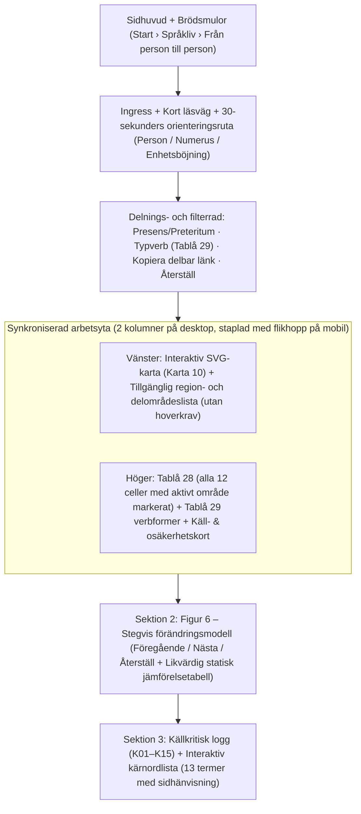

# Etapp 2 – Prototyp, informationsarkitektur och interaktionsspecifikation (`A02.1`–`A02.5`)

Detta dokument fastställer läsväg, skärmstruktur för mobil och dator, färg- och mönstersemantik, URL-kontrakt samt begriplighetsprövning för den interaktiva utgåvan av Adam Horn af Åminnes avhandling *Från person till person* (2022) under `/sprakliv/person-och-numerus`.

---

## 1. Huvudberättelse och kort läsväg (`A02.1`)

### 1.1 Huvudberättelse (utan att förvandla avhandlingen till en allmän svenskgrammatik)
Sidan fokuserar strikt på avhandlingens kärnfråga i kapitel 7: **hur de traditionella sydvästsvenska dialekterna (ca 1850–1950) stegvis avvecklade verbets personkongruens i plural indikativ genom analogisk utjämning mellan 1, 2 och 3 person**.

1. **Kontrasten som öppnar sidan**:
   - *Nutida standardsvenska (enhetsböjning)*: `vi kastar · ni kastar · de kastar` (samma form i alla personer och numerus).
   - *Äldre nysvenskt skriftspråk och a-området (ren numeruskongruens)*: `vi kasta · I kasta · de kasta` (plural skiljs från singular `jag kastar`, men alla tre pluralpersoner har samma form).
   - *Konservativ sydvästsvensk dialekt i um-området (personkongruens i plural)*: `vi kastum · I kasten · di kasta` (tre skilda pluraländelser i presens, och `vi kastam · I kastan · di kasta` i preteritum).
2. **Den korta läsvägen (2 minuter)**:
   - **Steg 1 (30 sek)**: Läs orienteringsrutan *Tre begrepp på 30 sekunder* (`personkongruens`, `ren numeruskongruens`, `enhetsböjning`).
   - **Steg 2 (60 sek)**: Välj mellan de fyra huvudområdena på **Karta 10** (`um-området`, `e-området`, `det skånska området`, `a-området`) och se hur cellerna i **Tablå 28** och exempelverben i **Tablå 29** slås ihop.
   - **Steg 3 (30 sek)**: Stega genom **Figur 6** (`Utgångsläge: um-böjning` → `Nordlig gren: e-böjning` / `Sydlig gren: skånsk böjning` → `Gemensam numerusböjning: a-böjning`).
3. **Fördjupningslager (valbara på samma sida utan att tynga huvudläsningen)**:
   - Växling mellan **presens** (`-a`) och **preteritum** (`-e`) samt fem fullständiga typverb ur **Tablå 29** (`kasta`, `dömma`, `ge`, `kunna`, `vara`) inklusive imperativ (`2s` och `2p`).
   - Klickbara **delområden och lokala undantag** (norra `n`-bortfallszonen `-e`, fotnot 81:s indirekt härledda områden i norra Halland och Blekinge, exklaven i Ale härad, `2a-böjning` i Redväg samt `generaliserad e-böjning` i Småland/Blekinge).
   - **Käll- och osäkerhetspanel** med tryckt sida, PDF-sida, underliggande arkivkällor och osäkerhetsruta (*Detta visar källan / Så har vi återgett det / Detta är osäkert*).

---

## 2. Skärmstruktur för dator och mobil (`A02.2`)

- **På dator (`> 980px`)**: Kartan (`Karta 10`) och regionknapparna ligger i vänsterkolumnen (`minmax(340px, 0.95fr)`), medan **Tablå 28**, valt typverb ur **Tablå 29** och **käll-/osäkerhetskortet** ligger klistrade bredvid i högerkolumnen (`minmax(380px, 1.05fr)`). Ett klick i kartan eller regionlistan uppdaterar omedelbart högerkolumnen.
- **På mobil (`<= 980px`)**: Regionknapparna ligger direkt ovanför kartan så att man kan byta område med tummen utan att behöva träffa små kartytor; direkt under kartan visas det valda områdets paradigm, verbexempel och källkort.

---

## 3. Färg- och mönstersemantik samt hoveroberoende (`A02.3`)

1. **Dubbel kodning (färg + SVG-mönster + textetikett)**:
   - `um-böjning` (`#C84B31`, röd): **Mönster A** (diagonala linjer) + etikett `1p ≠ 2p ≠ 3p`.
   - `e-böjning` (`#2B6CB0`, blå): **Mönster B** (horisontella linjer) + etikett `1p = 2p ≠ 3p`.
   - `skånsk böjning` (`#7B341E`, lila/rödbrun): **Mönster C** (krysslinjering) + etikett `1p = 3p ≠ 2p`.
   - `a-böjning` (`#2F855A`, grön): **Mönster D** (rut-/prickmönster) + etikett `1p = 2p = 3p`.
2. **Särskilda källkritiska kartlager**:
   - **Prickskraffering (`hasNDropDots`)**: Visar det nordliga området (norr om den vågformade gränslinjen i Halland–Västergötland–Småland) där `-e(n)` saknar finalt `/n/` och realiseras som `-e` (s. 147–148).
   - **Osäkerhetsskraffering + streckad kant (`isInferredFn81`)**: Visar `e-området i norra Halland` och `a-området i Blekinge`, där 1p och 2p saknar direkta belägg och gränsen dragits utifrån grannområdena enligt **fotnot 81 (s. 147)**.
   - **Ofärgad sydvästskånsk zon (`SW_SKANE_ENHETSBOJNING_PATH`)**: Markerad med ljus pappersyta och etikett `Enhetsböjning (ingen pluralböjning på Karta 10; jfr Karta 12 s. 151)`.
3. **Inget hoverberoende**:
   - Varje kartområde, delområde och dokumenterat undantag kan väljas både genom klick/tryck i SVG-kartan (med `tabIndex={0}`, `role="button"`, `Enter`/`Space`) **och** via den fullständiga textlistan med knappar direkt under/intill kartan.

---

## 4. Delbar URL, återställning och fokusordning (`A02.4`)

Implementerat i [`lib/thesis/url-state.ts`](../../lib/thesis/url-state.ts):

| Parameter | Tillåtna värden | Standardvärde | Beteende vid okänt värde |
| --- | --- | --- | --- |
| `omrade` | `region-um-omradet`, `region-e-omradet`, `region-skanska-omradet`, `region-a-omradet` | `region-um-omradet` | Faller tillbaka till `region-um-omradet` utan fel |
| `delomrade` | ID för något av de 9 delområdena (t.ex. `subarea-e-norra-halland-inferred-fn81`) | `null` (helt huvudområde) | Ignoreras om okänt; synkar `omrade` till delområdets ägarregion om giltigt |
| `tempus` | `presens`, `preteritum` | `presens` | Faller tillbaka till `presens` |
| `verb` | `kasta`, `dömma`, `ge`, `kunna`, `vara` | `kasta` | Faller tillbaka till `kasta` |
| `steg` | `1`, `2`, `3`, `4` (Figur 6) | `1` | Faller tillbaka till `1` |
| `vy` | `interaktiv`, `statisk-jamforelse` | `interaktiv` | Faller tillbaka till `interaktiv` |
| `begrepp` | ID i `glossary` (t.ex. `term-synkretism`) | `null` | Ignoreras om okänt |

- **Återställningsknapp**: Nollställer samtliga filter till standardläget (`/sprakliv/person-och-numerus`) med ett klick.
- **Tangentbordsfokus**: Logisk tabbordning: `Snabbfilter (Tempus / Typverb / Återställ)` → `Huvudområdesknappar (4 st)` → `Delområdesknappar i valt område` → `SVG-kartans delområden` → `Tablå 28-celler` → `Figur 6-styrning (Föregående / Steg 1–4 / Nästa / Statisk vy)` → `Ordlista`.

---

## 5. Begriplighetsprövning och genomförda revideringar (`A02.5`)

Inför byggandet av komponenterna prövades tre typiska missförstånd hos en läsare som inte är dialektolog:

1. **Missförstånd 1: ”Betyder `-a / -e` i Tablå 28 att man kan välja fritt mellan `-a` och `-e`?”**
   - *Lösning i gränssnittet*: Snedstrecket förklaras både i kolumnhuvudet och genom en aktiv **Tempusväxlare (`Presens -a` / `Preteritum -e`)** som omedelbart lyfter fram den aktuella tempusformen och visar ett konkret verbpar (`vi kastum` i presens mot `vi kastam` i preteritum).
2. **Missförstånd 2: ”Talar folk i Västergötland och Halland så här idag?”**
   - *Lösning i gränssnittet*: En tydlig **tids- och källbanderoll** i toppen av kart- och paradigmpanelen anger `Traditionella dialekter ca 1850–1950 (tyngdpunkt kring 1900) — ej nutida talspråk`.
3. **Missförstånd 3: ”Är alla gränser på Karta 10 lika säkra?”**
   - *Lösning i gränssnittet*: Ytterområdena i norra Halland och Blekinge har dubbel skraffering och streckad kontur på kartan samt en gul/korallfärgad **Fotnot 81-bricka** som direkt i detaljpanelen visar att endast 3 person plural är belagd där.
