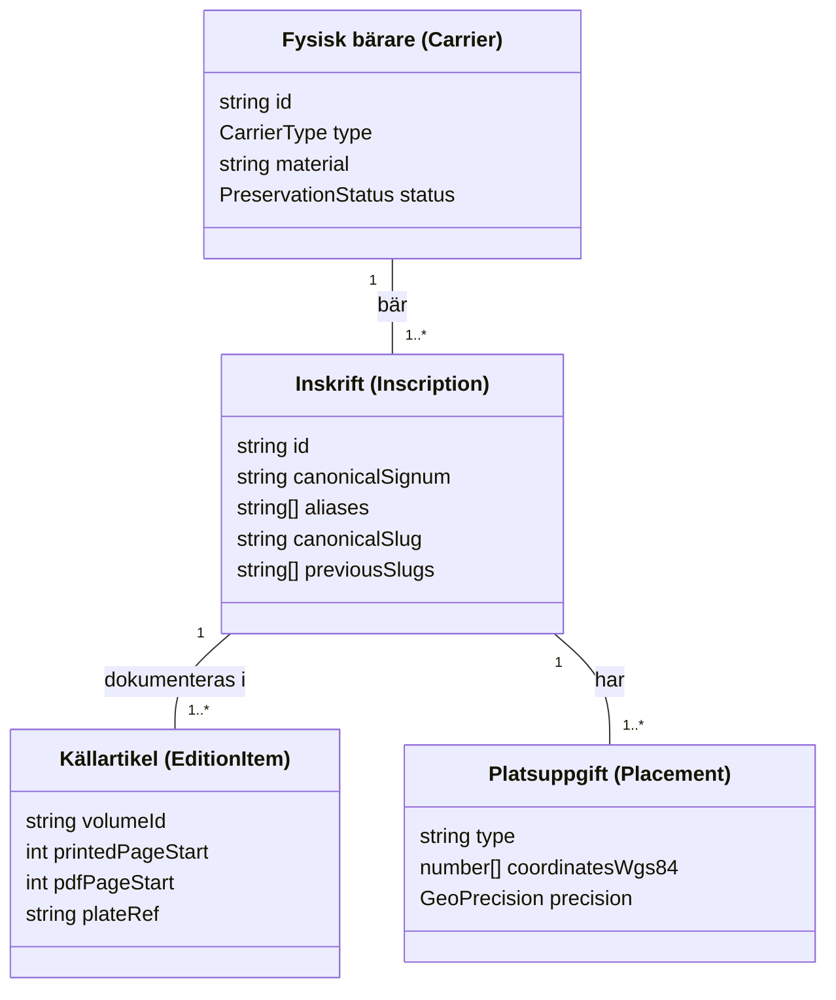

# E05 — Identitetskontrakt, signum och alias

**Projekt**: Runsidan på fornsvenska.se (`/runor`)  
**Datum**: 2026-10-21  
**Etapp-ID**: E05  
**Ansvar**: Dataansvarig och runologisk granskare  
**Beroenden**: E00, E04 (båda klara)  
**Referens**: [`RUNSIDA_PLAN.md`](./RUNSIDA_PLAN.md), [`ETAPPER.json`](./ETAPPER.json)  
**Status**: **GODKÄND (Klar)**

---

## 1. Syfte och grundprincip

För att förhindra att samma runinskrift dubbleras eller att olika objekt slås ihop av misstag gäller följande grundregel:
> **En fysisk bärare $\neq$ en inskrift $\neq$ en utgåvas artikel $\neq$ en kartmarkör.**

Relationerna mellan dessa entiteter modelleras explicit med stabila interna ID:n.

---

## 2. Entitetsseparation

---

## 3. Identitets- och signumnormering

### 3.1 Signumstruktur
Ett signum består av tre formella delar:
1. **Landskapskod (`provinceCode`)**: Enligt vedertagen standard i *Sveriges runinskrifter* och Rundata:
   `Öl` (Öland), `Ög` (Östergötland), `Sö` (Södermanland), `Sm` (Småland), `Vg` (Västergötland), `U` (Uppland), `G` (Gotland), `Vs` (Västmanland), `Nä` (Närke), `Vr` (Värmland), `Gs` (Gästrikland), `DR` (Danmark/Skåne/Blekinge/Halland), `N` (Norge/Bohuslän/Jämtland).
2. **Löpnummer (`number`)**: Positivt heltal (t.ex. `1`, `112`, `136`).
3. **Suffix (`suffix`)**: Valfri avgränsare för sidor, partier eller fragment (t.ex. `A`, `B`, `§A`, `§B`, `M`).

**Kanoniskt signum**: Mellanslag mellan landskapskod och nummer, t.ex. `Öl 1`, `U 112`, `Ög 136`.

### 3.2 URL-sluggar och slughistorik
- Kanonisk URL-slug genereras deterministiskt från landskapskod och nummer med små bokstäver och bindestreck utan diakritika:
  - `Öl 1` $\rightarrow$ `/runor/ol-1`
  - `Ög 136` $\rightarrow$ `/runor/og-136`
  - `U 112` $\rightarrow$ `/runor/u-112`
  - `Sö 101` $\rightarrow$ `/runor/so-101`
- Vid ändrat signum eller sammanslagning sparas gamla sluggar i `previousSlugs` och ger permanent 301-omdirigering.

### 3.3 Externa identifierare
Varje inskriftsparadigm lagrar:
- `samnordisk_uuid`: UUID i Samnordisk runtextdatabas (t.ex. `28485f9b-7b54-48d5-b065-f6611fd3268d`).
- `raa_uri`: Permanent URI i RAÄ:s Runor-tjänst (`https://app.raa.se/open/runor/inscription?item_key=...`).
- `kulturarvsdata_uri`: URI i K-samsök (`http://kulturarvsdata.se/...`).

---

## 4. Hantering av komplexa svårfall

### Fall A: Två inskrifter på samma bärare
*Exempel: Runblock eller häll med ristningar från olika tidpunkter eller ristare.*
- En gemensam `Carrier`-post (t.ex. `carrier-u-112` för det fasta runblocket).
- Två separata `Inscription`-poster: `U 112A` och `U 112B`, länkade till samma bärare men med egna textversioner, ristare och tolkningar.

### Fall B: Samma inskrift bevarad i flera separata fragment
*Exempel: Ett runstensfragment funnet i kyrkogårdsmuren, ett annat i grunden.*
- En gemensam `Inscription`-post (`Öl 15`).
- Flera `Fragment`-poster länkade till inskriften, vardera med egna mått och fyndanteckningar.

### Fall C: Äldre och alternativa litteratursignum (Alias)
*Exempel: Bautil (B 102), Liljegren (L 135), Brate eller äldre RAÄ-nummer.*
- Registreras i `aliases`-arrayen. Sökning på ett alias hittar rätt inskrift utan att ändra det officiella primärsignumet.

---

## 5. Slutsats och beslut för E05

Identitetskontraktet är formaliserat, stöder enkla och sammansatta signum, fragment och alias utan att förvanska källans identitet.

Etapp E05 kvitteras härmed som **KLAR**.
