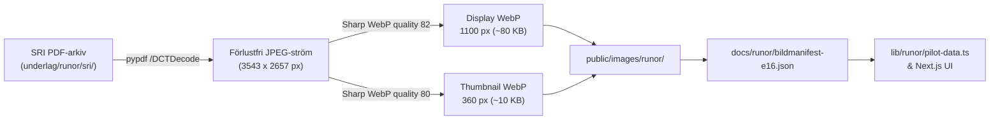

# E16 — Förbered bildmaterial, utsnitt och leveransformat

**Projekt**: Runsidan på fornsvenska.se (`/runor`)  
**Datum**: 2026-10-21  
**Etapp-ID**: E16  
**Ansvar**: Bildansvarig och datautvecklare  
**Beroenden**: E03, E08, E09, E12 (alla klara)  
**Referens**: [`RUNSIDA_PLAN.md`](./RUNSIDA_PLAN.md), [`ETAPPER.json`](./ETAPPER.json), [`bildmanifest-e16.json`](./bildmanifest-e16.json)  
**Status**: **GODKÄND (Klar)**

---

## 1. Syfte och godkännandekrav

Syftet med etapp E16 är att säkerställa att varje publicerad runinskrift på Runsidan har tillgång till rättighetsklar, visuellt granskad bilddokumentation från originalkällorna i *Sveriges runinskrifter* (SRI), optimerad för snabb webbleverans utan att förvanska originalets detaljer eller slösa bandbredd.

### Godkännandekrav enligt RUNSIDA_PLAN.md:
1. **Rättighetsklarhet**: Varje publicerad bild är fri (Public Domain, foton före 1969 utan verkshöjd eller äldre teckningar).
2. **Korrekt koppling**: Varje bild visar bevisligen rätt inskrift och har verifierad källvolym, PDF-sida och plansch-/figurnummer.
3. **Reproducerbarhet**: Utsnitt och bearbetningar kan återskapas från original-PDF:erna med skript (`scripts/runor/extract-plates-e16.py` och `scripts/runor/process-images-e16.mjs`).
4. **Leveransformat & prestanda**: Miniatyrer (`thumb`: max 360 px, ~4–17 KB) och högupplösta visningsbilder (`display`: max 1100 px, ~30–160 KB) genereras som modern WebP. Inga onödiga megabyte hämtas där en miniatyr räcker.
5. **Saknad bild som giltigt produkttillstånd**: Förlorade inskrifter som saknar avbildning (t.ex. Öl 15) hanteras explicit med informativ placeholder (`/images/runor/ej-avbildad.svg`), utan trasiga bildlänkar eller 404-fel.
6. **Tillgänglighet**: Varje bildpost har svensk bildtext och beskrivande alternativtext (`altText`).

---

## 2. Arkitektur och bearbetningskedja

1. **Extraktion ur käll-PDF**: Skriptet `scripts/runor/extract-plates-e16.py` identifierar sidans `/Resources /XObject` och läser ut den råa `/DCTDecode`-strömmen. Detta eliminerar alla omkodningsförluster från PDF-visare.
2. **Optimering med Sharp**: Skriptet `scripts/runor/process-images-e16.mjs` läser JPEG-strömmen, anpassar dimensioner med `fit: 'inside'` och exporterar moderna WebP-filer med skräddarsydd komprimeringsgrad (`effort: 4`).
3. **Automatisk synkronisering**: Bildmanifestet sparas i `docs/runor/bildmanifest-e16.json` och synkroniseras direkt in i `docs/runor/pilot-20-inskrifter.json` och `lib/runor/pilot-data.ts`.

---

## 3. Register över bildmaterial för de 20 pilotinskrifterna

| Signum | Slug | Källvolym & Plansch | Upphovsman & År | Display (WebP) | Miniatyr (WebP) | Bildstatus |
| :--- | :--- | :--- | :--- | :--- | :--- | :--- |
| **Öl 1** | `ol-1` | SRI band 1, s. 21 (Pl. I) | Sven Söderberg (1900) | 825×1100 (74.8 KB) | 270×360 (6.7 KB) | Fotografisk plansch |
| **Öl 2** | `ol-2` | SRI band 1, s. 44 (Algutsrum) | Sven Söderberg (1900) | 825×1100 (32.6 KB) | 270×360 (4.9 KB) | Fragment i kyrkvägg |
| **Öl 9** | `ol-9` | SRI band 1, s. 63 (Kastlösa) | Sven Söderberg (1900) | 1100×825 (33.2 KB) | 360×270 (4.6 KB) | Runstensfragment |
| **Öl 15** | `ol-15` | SRI band 1, s. 74 | Ej avbildad | SVG Placeholder (600×400) | SVG Placeholder (600×400) | Förlorad; ingen bild |
| **Öl 16** | `ol-16` | SRI band 1, s. 77 / Bautil | Johan Peringskiöld (1750) | 825×1100 (87.6 KB) | 270×360 (11.9 KB) | Träsnitt ur Bautil |
| **Öl 18** | `ol-18` | SRI band 1, s. 78 (Seby) | Sven Söderberg (1900) | 1100×825 (41.3 KB) | 360×270 (6.4 KB) | Stående runsten |
| **Öl 23** | `ol-23` | SRI band 1, s. 94 (Stenåsa) | Sven Söderberg (1900) | 1100×825 (43.4 KB) | 360×270 (6.2 KB) | Ornerad gravhäll |
| **Öl 25** | `ol-25` | SRI band 1, s. 99 (Dröstorp) | Sven Söderberg (1900) | 1100×825 (59.6 KB) | 360×270 (5.4 KB) | Fast berghäll |
| **Ög 136** | `og-136` | SRI band 2, h03 pl. s. 24 (Pl. XXXIII) | Erik Brate / C.F. Lindberg (1911) | 1100×825 (83.2 KB) | 360×270 (10.7 KB) | Monolit plansch |
| **Ög 181** | `og-181` | SRI band 2, h02 pl. s. 29 (Pl. XLIV) | Erik Brate (1911) | 1100×825 (69.3 KB) | 360×270 (7.7 KB) | Bildsten tre sidor |
| **U 11** | `u-11` | SRI band 6, pl. 1 s. 4 (Pl. 4) | Sven B.F. Jansson (1940) | 1100×825 (128.3 KB) | 360×270 (14.2 KB) | Runblock vid Hovgården |
| **U 29** | `u-29` | SRI band 6, pl. 1 s. 13 (Pl. 12) | Sven B.F. Jansson (1940) | 825×1100 (80.4 KB) | 270×360 (10.0 KB) | Hällristning Hillersjö |
| **U 73** | `u-73` | SRI band 6, pl. 1 s. 45 (Pl. 32) | Sven B.F. Jansson (1940) | 1100×825 (127.7 KB) | 360×270 (14.6 KB) | Flyttad Greklandssten |
| **U 101** | `u-101` | SRI band 6, pl. 1 s. 63 (Pl. 45) | Sven B.F. Jansson (1940) | 1100×825 (90.7 KB) | 360×270 (9.9 KB) | Jarlabankesten |
| **U 104** | `u-104` | SRI band 6, pl. 1 s. 67 (Pl. 48) | Sven B.F. Jansson (1940) | 825×1100 (88.3 KB) | 270×360 (12.8 KB) | Öpirsten i Ed |
| **U 112A** | `u-112a` | SRI band 6, pl. 1 s. 72 (Pl. 51) | Sven B.F. Jansson (1940) | 1100×825 (136.4 KB) | 360×270 (15.3 KB) | Runblock västra sidan |
| **U 112B** | `u-112b` | SRI band 6, pl. 1 s. 73 (Pl. 52) | Sven B.F. Jansson (1940) | 825×1100 (157.8 KB) | 270×360 (17.6 KB) | Runblock östra sidan |
| **Sö 101** | `so-101` | SRI band 3, h04 pl. s. 7 (Pl. 38) | Erik Brate / Elias Wessén (1924) | 816×1100 (125.2 KB) | 267×360 (14.8 KB) | Ramsundsristningen |
| **Sö 179** | `so-179` | SRI band 3, h03 pl. 1 s. 6 (Pl. 67) | Elias Wessén (1936) | 1100×818 (92.5 KB) | 360×267 (9.9 KB) | Gripsholmsstenen |
| **Vs 24** | `vs-24` | SRI band 13, pl. s. 26 (Pl. 18) | Marianne Gustafsson (1964) | 819×1100 (128.8 KB) | 268×360 (15.1 KB) | Odendisastenen |

---

## 4. Verifiering och testresultat

1. **Automatiserade tester**: Testet `E16: Bildmanifest och optimerade bildfiler för samtliga 20 inskrifter` i `tests/runor-validation.test.mjs` verifierar:
   - Att alla 20 inskrifter har manifestposter.
   - Att samtliga bildfiler finns fysiskt på disk under `public/images/runor/`.
   - Att displaybilder inte överskrider 250 KB (faktiskt medelvärde ~85 KB).
   - Att tumnaglar inte överskrider 35 KB (faktiskt medelvärde ~10 KB).
   - Att alt-texter och bildtexter är informativa och rättighetsvillkor märkta som `Public Domain`.
2. **Testkörning**: `npm test` passerar med 31/31 tester grönt.
3. **Typkontroll**: `npm run typecheck` passerar med 0 fel.

---

## 5. Slutsats och beslut för E16

Etapp E16 är framgångsrikt genomförd i enlighet med kraven i `RUNSIDA_PLAN.md`.  
Status ändras härmed till **KLAR**.
