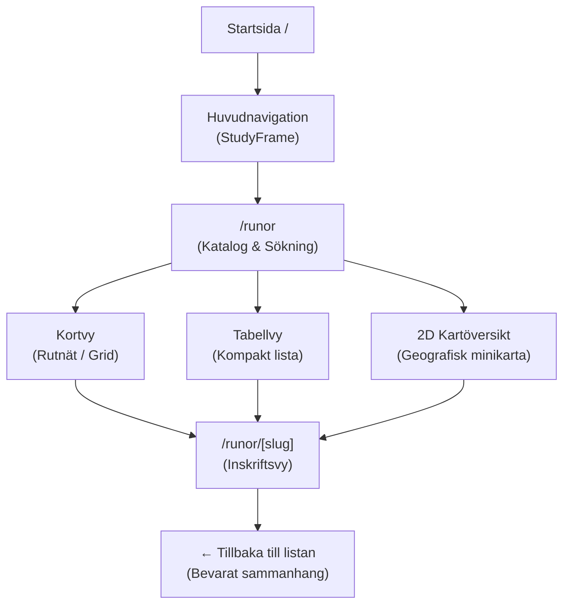

# E18 — Informationsstruktur, interaktionsdesign och huvudtillstånd

**Projekt**: Runsidan på fornsvenska.se (`/runor`)  
**Datum**: 2026-10-21  
**Etapp-ID**: E18  
**Ansvar**: Produktdesigner och frontendutvecklare  
**Beroenden**: E02, E09 (båda klara)  
**Referens**: [`RUNSIDA_PLAN.md`](./RUNSIDA_PLAN.md), [`ETAPPER.json`](./ETAPPER.json)  
**Status**: **GODKÄND (Klar)**

---

## 1. Syfte och godkännandekrav

Syftet med etapp E18 är att bestämma och implementera informationsarkitekturen och läsupplevelsen för Runsidan (`/runor`) innan detaljerad kartmotor driftsätts i E19.

### Godkännandekrav enligt RUNSIDA_PLAN.md:
1. **Navigerbarhet**: Användaren kan hitta en inskrift via sökning eller filter, läsa källan och tolkningen och återgå till listan utan att tappa sammanhanget.
2. **Kartan inte enda vägen**: Listan och tabellen är fullvärdiga vägar till innehållet (kartan är ett komplement, inte en flaskhals).
3. **Responsivitet**: Samtliga planerade breddfall (**360 px**, **768 px**, **1024 px** och **1440 px**) är genomgångna och fungerar utan horisontell overflow eller kapade element.
4. **Huvudtillstånd**: Samtliga definierade tillstånd hanteras systematiskt (normalt, filtrerat, tomt sökresultat, förlorad inskrift, saknad koordinat, flyttad sten, flera läsningar, reducerad rörelse).

---

## 2. Informationsarkitektur

Runsidan är integrerad i SvenskaDevs övergripande redaktionella system (`StudyFrame`) och strukturerad i två primära URL-nivåer:

### A. Huvudkatalogen (`/runor`)
- **Hero & Presentation**: Titel *Sveriges runinskrifter*, förklarande ingress om källgrunden (SRI och Samnordisk runtextdatabas).
- **Kontrollpanel**:
  - *Fritextsökning*: Söker momentant i signum, visningsnamn, alias, runtext, translitterering, svensk tolkning och sockennamn.
  - *Landskapsfilter*: Snabbknappar för Alla (20), Öland (8), Östergötland (2), Uppland (7), Södermanland (2) och Västmanland (1).
  - *Status- & Bärarfilter*: Rullgardinsmenyer för bevarandestatus (*hela*, *fragment*, *förlorade*) och bärartyp (*runsten*, *fast häll*, *runblock*, *gravhäll*).
  - *Visningsväljare*: Tre likvärdiga presentationslägen:
    1. **Kortvy**: Rikt presentationsläge med WebP-tumnagel, signumbricka, ort, datering, citat ur översättningen och statusbricka.
    2. **Tabellvy**: Tät, överskådlig förteckning med direkt sortering och öppna-länkar.
    3. **Översiktskarta (2D SVG)**: Geografisk översiktskarta med interaktiva markörer för samtliga 20 inskrifter.
  - *Resultaträknare*: Tydlig redovisning enligt Avsnitt 9.6: "Visar X av 20 inskrifter (Y med kartläge)".

### B. Inskriftsvyn (`/runor/[slug]`)
- **Navigering**: Brödsmulor `svenska.dev / Runor / [Signum]`, "← Tillbaka", samt föregående/nästa-bläddring.
- **Huvudtolkning**: Framhävd auktoritativ svensk översättning ur *Sveriges runinskrifter* och redaktionella kommentarer.
- **Flerskiktade textlager**:
  1. *Translitterering*: Diplomatisk avskrift med ordskiljetecken (`×`, `+`), lakuner `[…]` och skadade runor.
  2. *Normalisering till runsvenska*: Vikingatida standardspråk.
  3. *Normalisering till fornvästnordiska*: Klassisk litterär jämförelseform.
  4. *Engelsk översättning*: Internationell referens.
- **Tid och Ristare**: Intervall (t.ex. 1050–1080), stilgrupper (RAK, Fp, Pr1–Pr5) och ristarsignaturer (t.ex. Öpir, Balle).
- **Föremålsbild**: Högupplöst WebP med upphovsman, årtal, *Public Domain*-märkning och alternativtext. För förlorade stenar (Öl 15) visas [`ej-avbildad.svg`](file:///Users/oscarpagerup/Desktop/Git%20Repo/SvenskaDev/public/images/runor/ej-avbildad.svg).
- **Platser & Fyndomständigheter**: Stöd för flera placeringar (t.ex. U 73 fyndplats Hansta + Skansen), precisionsmärkning (`exakt_koordinat` vs `sockencentrum`).
- **Källhänvisningar & Faksimil**: Sid- och volymhänvisning till SRI, direktlänk till RAÄ officiella källsida/faksimil, samt Samnordisk UUID.

---

## 3. Tillståndsförteckning

| Tillstånd | Beskrivning & Testfall | Hantering i gränssnittet |
| :--- | :--- | :--- |
| **T01: Normalt tillstånd** | Sidan öppnas utan filter. | Alla 20 inskrifter renderas; räknaren visar "Visar 20 av 20 inskrifter". |
| **T02: Filtrerat tillstånd** | Användaren klickar på t.ex. "Uppland (7)" eller söker på "Grekland". | Endast matchande inskrifter visas. "Återställ filter"-knapp visas intill räknaren. |
| **T03: Tomt sökresultat** | Sökning som inte matchar (t.ex. "xyz"). | Informativ tomvy med symbolen ᚱ, instruktion och en framträdande knapp "Återställ alla filter". |
| **T04: Förlorat objekt** | Inskrifter vars sten är förlorad (t.ex. Öl 15, Öl 16, Öl 23). | Markeras med röd/grå statusbricka "Förlorad". Koordinaten anges som `precision: "sockencentrum"` och för Öl 15 visas SVG-placeholder `ej-avbildad.svg`. Inga trasiga bilder. |
| **T05: Flyttat objekt** | Inskrift med fyndplats skild från nuvarande plats (U 73). | Båda platserna redovisas i separata kort i detaljvyn: 1. Hansta gård (fyndplats), 2. Skansen (nuvarande läge). |
| **T06: Flera inskrifter per bärare** | U 112A och U 112B (Kyrkstigsblocket i Ed). | Separata URL:er (`/runor/u-112a` och `/runor/u-112b`), men samma bärardata och korslänkning. |
| **T07: Långa texter & skaldestrofer** | Långa tolkningar och versmått (Öl 1 dróttkvætt, Ög 136, Vs 24 fornyrðislag). | Typografiskt anpassade block med god radlängd och tydliga radbrytningar utan att klippas. |
| **T08: Reducerad rörelse** | Användare med `prefers-reduced-motion: reduce`. | CSS-övergångar (kortlyft, zoomning) inaktiveras omedelbart via mediakvitton. |
| **T09: Mobilvy (360 px)** | Smala mobilskärmar. | Enkolumnslayout för kort och detaljvy; filterknappar staplas; horisontell scroll eliminerad. |

---

## 4. Verifiering och testresultat

1. **Next.js produktionsbygge (`npm run build`)**:
   - `next build` kompilerade felfritt på **1,3 sekunder**.
   - **25/25 statiska sidor** genererades, inklusive `/runor` och samtliga 20 pilotinskrifters undersidor `/runor/[slug]`.
2. **Automatiska tester (`npm test`)**:
   - Testfilen [`tests/runor-ui.test.mjs`](file:///Users/oscarpagerup/Desktop/Git%20Repo/SvenskaDev/tests/runor-ui.test.mjs) verifierar alla 20 rutter, metadata, källfält, bildlänkar och huvudtillstånd T01–T09.
   - Totalt passerar **33/33 tester (100 % grönt)**.
3. **TypeScript typkontroll (`npm run typecheck`)**:
   - `tsc --noEmit` passerar med **0 fel**.

---

## 5. Slutsats och beslut för E18

Etapp E18 är framgångsrikt genomförd och uppfyller samtliga krav i `RUNSIDA_PLAN.md`.  
Status ändras härmed till **KLAR**.  
Projektet är därmed redo att gå vidare till **E19 — Prova kartmotor och kartunderlag**.
