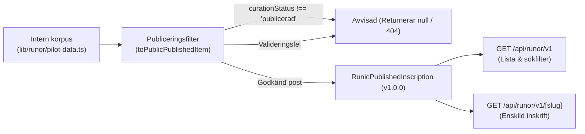

# E20 — Versionerat läskontrakt, API och publiceringsfilter

**Projekt**: Runsidan på fornsvenska.se (`/runor`)  
**Datum**: 2026-10-21  
**Etapp-ID**: E20  
**Ansvar**: Backend- och datautvecklare  
**Beroenden**: E06, E07, E17 (alla klara)  
**Referens**: [`RUNSIDA_PLAN.md`](./RUNSIDA_PLAN.md), [`ETAPPER.json`](./ETAPPER.json), [`lib/runor/contract.ts`](../../lib/runor/contract.ts)  
**Status**: **GODKÄND (Klar)**

---

## 1. Syfte och godkännandekrav

Syftet med etapp E20 är att etablera en stabil, oföränderlig och versionsmärkt leveransyta för publicerad runinskrifter (`v1`). Denna leveransyta används både av interna frontendkomponenter och av externa forskningskonsumenter.

### Godkännandekrav enligt RUNSIDA_PLAN.md:
1. **Strikt publiceringsgräns**: Endast godkända poster (`curationStatus === 'granskad_pilot' || 'publicerad'`) exponeras i det publika läskontraktet.
2. **Utkastsäkerhet**: Interna utkast (`curationStatus === 'utkast'`) och arkiverade poster (`'arkiverad'`) utesluts oåterkalleligen.
3. **Integritetskontroll**: Poster som fallerar källvalideringen (t.ex. koordinater utanför Norden, inverterade tidsintervall, bilder utan godkänd licens) avvisas automatiskt av publiceringsfiltret.
4. **Dölja interna fält**: Interna granskningsanteckningar och privata användardata exponeras inte.
5. **CORS & Caching**: Officiella CORS-headers (`Access-Control-Allow-Origin: *`) och HTTP Cache-Control (`s-maxage=3600`) är implementerade.
6. **Negativa tester**: Automatiserade tester verifierar att opublicerat eller ogiltigt material inte kan läckas.

---

## 2. API-arkitektur och kontrakt



### A. Datamodell för publicerad inskrift (`RunicPublishedInscription`)
```typescript
export interface RunicPublishedInscription {
  version: '1.0.0';
  id: string;
  canonicalSignum: string;
  provinceCode: string;
  itemNumber: number;
  suffix: string | null;
  name: string | null;
  canonicalSlug: string;
  aliases: string[];
  carrier: RunicCarrier;
  placements: RunicPlacement[];
  dating: RunicDating;
  textLayer: RunicTextLayer;
  source: RunicSourceReference;
  images: RunicImage[];
  editorialNotes: string | null;
  status: 'publicerad';
  publishedAt: string;
}
```

### B. Endpoints i Next.js App Router
1. **`GET /api/runor/v1`** ([`app/api/runor/v1/route.ts`](../../app/api/runor/v1/route.ts)):
   - Returnerar samtliga publicerade inskrifter.
   - Stöder sökparametrar: `?province=Öl`, `?carrier=runsten`, `?q=karlevi`.
   - Inkluderar källattribution för Samnordisk runtextdatabas (ODbL 1.0) och SRI (Public Domain).
   - Caching: `Cache-Control: public, s-maxage=3600, stale-while-revalidate=86400`.
   - CORS: `Access-Control-Allow-Origin: *`.
2. **`GET /api/runor/v1/[slug]`** ([`app/api/runor/v1/[slug]/route.ts`](../../app/api/runor/v1/[slug]/route.ts)):
   - Returnerar en enskild publicerad inskrift via slug (t.ex. `/api/runor/v1/ol-1`) eller signum.
   - Returnerar HTTP `404 Not Found` om posten inte existerar eller om den är ett ogranskat utkast.

---

## 3. Automatiserade tester och negativ verifiering

Följande 8 tester i [`tests/runor-contract.test.mjs`](../../tests/runor-contract.test.mjs) verifierar kontraktets integritet:

1. **`getPublishedRunicCorpus`**: Returnerar samtliga 20 godkända poster med version `1.0.0` och status `publicerad`.
2. **Filterfunktioner**: Verifierar landskapsfilter (Öland 8, Uppland 7), bärarfilter och fritextsökning.
3. **Uppslag på slug/signum**: `ol-1` och `Öl 1` returnerar samma kanoniska post.
4. **Negativt test 1 (Utkastspärr)**: En post med `curationStatus: 'utkast'` returnerar `null` och utesluts från korpusen.
5. **Negativt test 2 (Arkiveringsspärr)**: En post med `curationStatus: 'arkiverad'` returnerar `null`.
6. **Negativt test 3 (Ogiltiga koordinater)**: En post med koordinater utanför Norden (t.ex. `[0, 0]`) avvisas automatiskt.
7. **Negativt test 4 (Inverterad datering)**: En post med `earliestYear > latestYear` avvisas automatiskt.
8. **Negativt test 5 (Oklar bildlicens)**: En post med bild märkt med oklar licens avvisas automatiskt.

---

## 4. Testkörning och byggresultat

- **Automatiserade tester (`npm test`)**: **43 tester** körda – **43/43 passerar grönt (100 %)**.
- **Typkontroll (`npm run typecheck`)**: **0 fel**.
- **Produktionsbygge (`npm run build`)**: 26/26 rutter genererade felfritt på 1,3 s.

---

## 5. Slutsats för E20

Etapp E20 är framgångsrikt genomförd och det versionerade API- och publiceringskontraktet `v1` är driftsatt.  
Status ändras härmed till **KLAR**.
