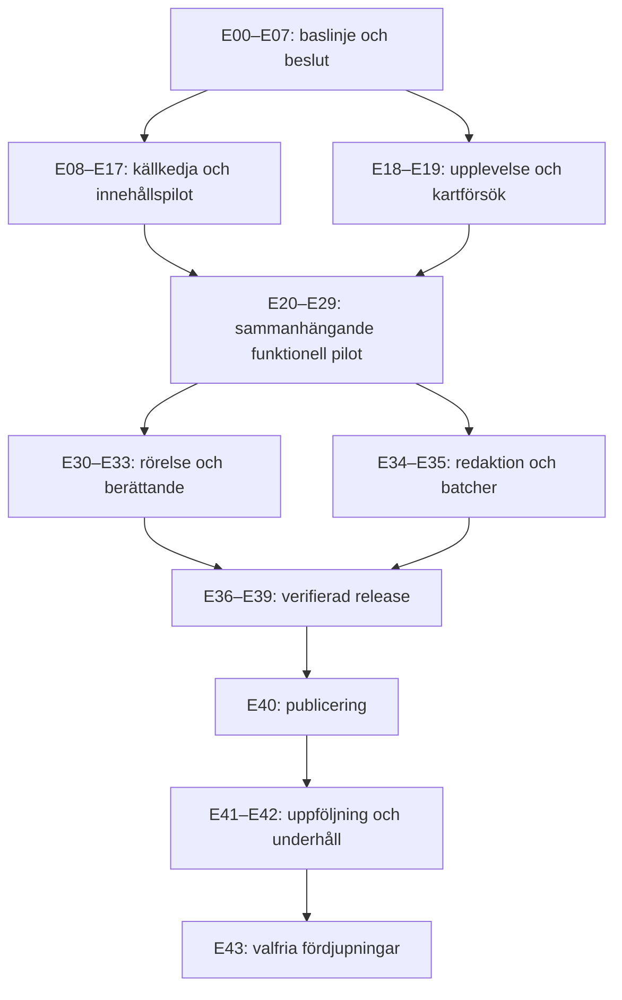

# Runsidan på fornsvenska.se — genomförandeplan

**Version 2.0 · 21 oktober 2026 · 44 etapper**

Målet är en källbunden, levande runatlas: en responsiv Sverigekarta där besökaren kan upptäcka en inskrift, förstå dess text och osäkerheter och öppna rätt förlaga. Kartan, läsvyn och de pedagogiska fördjupningarna ska bilda en sammanhängande upplevelse i den befintliga sajten.

Insamlingen är genomförd. **Kartläggning av individuella inskrifter, koordinatimport, vetenskaplig innehållsgranskning och webbimplementation är fortfarande planerade arbeten.** Att en PDF är hämtad och tekniskt läsbar är inte ett godkännande av dess OCR eller sakuppgifter.

Planen är ordnad efter beroenden och risk: först evidens och datamodell, sedan en fullständig liten pilot, därefter gränssnitt, rörelse, uppskalning och drift. Tidig design och karttekniska försök kan ske medan innehåll granskas, men en senare milstolpe får inte passeras genom att hoppa över föregående kvalitetskrav.

## Läsanvisning och status

- Avsnitt 1–6 beskriver materialet, produktidén och arkitekturriktningen.
- Avsnitt 7 innehåller alla 44 etapper med beroenden, ansvar, arbetsmoment, leverans, godkännandekrav och hantering av underkänt resultat.
- Avsnitt 8–14 specificerar kravspårning, datakvalitet, mätbudgetar, tester, beslut, risker och kapacitetsplanering.
- Avsnitt 15 är den konkreta arbetsordningen från dagens läge.
- [ETAPPER.json](ETAPPER.json) innehåller samma etapp-ID:n, beroenden och kriterier i maskinläsbar form. Den är underlag för framtida uppföljning, inte ett kvitto på utfört arbete.

Status är **klar för samtliga 44 etapper E00–E43** (**Milstolparna M0, M1, M2, M3, M4, M5, M6 och M7 fullbordade och godkända**; 44 av 44 etapper slutförda med 163 automatiserade regressionstester och 0 fel). Runsidan på fornsvenska.se är skarpt lanserad med full källkedja, verifierade kartor, tillgänglighetsgranskning, felresiliens och långsiktig förvaltningsplan. Statusen *klar* åtföljs för varje etapp av länkat arbetsresultat, testsvit och dokumenterad evidens.

Rollnamnen i planen betecknar ansvarsfunktioner. De betyder inte att flera personer redan är tillgängliga. Samma person kan ha flera roller, men oberoende sakgranskning får bara kallas oberoende när den faktiskt utförts av en annan kvalificerad granskare. Teknisk och redaktionell kompetens ska bedömas separat.

## 1. Verifierat utgångsläge och bevarat källunderlag

Källsida: [Digitala Sveriges runinskrifter – publicerade volymer, RAÄ](https://www.raa.se/kulturarv/runor-och-runstenar/digitala-sveriges-runinskrifter/digitala-sveriges-runinskrifter-publicerade-volymer/).

Sidan har **129 unika PDF-länkar i 15 volymdelar**, fördelade över tio landskap. Det är 129 dokument, inte 129 individuella runinskrifter. Materialet omfattar utgåvor från 1900–1981. Hela listan ingår, även avsnitten efter Öland. Externa katalogtjänster och supplement på andra webbsidor ingår inte i denna första hämtning.

| Del | Utgåva | PDF-filer |
|---|---|---:|
| 1 | Öland | 2 |
| 2 | Östergötland | 7 |
| 3 | Södermanland | 19 |
| 4 | Småland | 9 |
| 5 | Västergötland | 14 |
| 6 | Uppland, del 1 | 12 |
| 7 | Uppland, del 2 | 12 |
| 8 | Uppland, del 3 | 16 |
| 9 | Uppland, del 4 | 15 |
| 11 | Gotland, del 1 | 4 |
| 12 | Gotland, del 2 | 6 |
| 13 | Västmanland | 3 |
| 14:1 | Närke | 3 |
| 14:2 | Värmland | 3 |
| 15:1 | Gästrikland | 4 |

Tabellen är en inventering av länkarna. Insamlingen är slutförd: **129/129 filer, 4 440 853 483 byte och 7 217 PDF-sidor**. Alla filer är tekniskt analyserade och har varsin unik SHA-256. Utfallet finns i `nedladdningsmanifest.json` och `pdf-analys.json`. Band 10 saknas enligt källsidan. Denna lista är inte heltäckande för Sveriges runinskrifter: ett landskap utan material här får inte beskrivas som ett landskap utan runor.

### Lokal struktur

- `underlag/runor/sri/band-*/`: oförändrade PDF-original med RAÄ:s filnamn.
- `underlag/runor/sri/kallsida.html`: lokal ögonblicksbild av länksidan.
- `underlag/runor/sri/text/`: extraherad text, dels läsbar TXT, dels JSONL med ett objekt per PDF-sida.
- `docs/runor/nedladdningsmanifest.json`: ursprungslänk, volym, länktext, lokal sökväg, hämtningstid, byteantal och SHA-256.
- `docs/runor/pdf-analys.json`: teknisk inventering av varje PDF, sidantal, metadata och textmängd per sida.
- `docs/runor/INSAMLING.md`: slutlig sammanställning efter hämtning och kontroll.

Original och textextrakt ligger utanför `public/` och är Git-ignorerade. Manifest, analys och verktyg kan versionshanteras utan att göra webbbygget flera gigabyte större. Säkerhetskopiera originalmappen separat; den följer inte med en vanlig Git-klon.

## 2. Vad analysen betyder för bygget

Den tekniska analysen öppnar samtliga hämtade PDF-sidor, extraherar hela det befintliga textlagret och verifierar filernas SHA-256 på nytt. Den bedömer inte automatiskt om läsningar, dateringar eller översättningar är riktiga. Full extraktion är inte detsamma som vetenskaplig genomläsning av varje artikel.

Visuell provkontroll har gjorts av en textsida i Ölands första häfte (PDF-sida 19, tryckt sida 15) och Östergötlands plansch I (PDF-sida 2 i första planschfilen). Texten går att söka i, medan runformer, specialtecken och avstavningar måste jämföras med sidbilden. Plansch I innehåller flera figurer med olika signum: det behövs en relation mellan inskrift, plansch, figur och bildutsnitt.

Praktiska konsekvenser:

1. **PDF-fil och inskrift är olika saker.** En inskrift kan gå över flera sidor och ha bilder i en separat fil. Ett filintervall på länksidan är inte ett register över individuella objekt.
2. **PDF-sida och tryckt sida måste lagras separat.** Förblad, romerska sidtal och planscher ger olika paginering. Ingen global sidförskjutning kan antas gälla hela serien.
3. **OCR används för att hitta, inte för att fastställa runtexten.** Osäkra tecken, luckor, bindrunor och alternativa läsningar bevaras. Normalisering av sökfält får aldrig skriva över källtexten.
4. **Historisk beskrivning är inte aktuellt tillstånd.** En uppgift om plats, bevarande eller läsning i en äldre volym måste märkas med källa och tid. Fyndplats och nuvarande placering kan skilja sig.
5. **Kartans precision kräver en separat datakälla.** Ortsnamn i PDF:erna räcker inte för säkra markörer. Lägg inte varje sten vid socknens mittpunkt och presentera det som exakt läge.
6. **Bildrättigheter behöver följa varje bild.** Fri läsning av en PDF ska inte tolkas som en generell licens för all återpublicering, beskärning eller bearbetning. Originalutgåva, fotograf och eventuella licensvillkor dokumenteras inför publicering av bilder.

## 3. Förslag till upplevelse: en levande runatlas

Ny ingång **Runor**, med adress `/runor`. Materialet får sträcka sig över hela den tidsrymd källorna omfattar; ingen generell begränsning till 1225–1526 ska införas. Besökaren möts av en lugn, responsiv Sverigekarta i webbplatsens befintliga färger och typografi. Kluster visar hur mycket verifierat material som finns i olika områden. Ett klick på landskap eller kluster zoomar in; ett klick på en inskrift öppnar dess berättelse och förlaga.

Sidan ska kännas levande genom rörelser som hjälper läsningen:

- Mjuk förflyttning från Sverige till vald inskrift, med en kort markering av valet.
- Kluster som delas när man zoomar, i stället för tusentals överlappande markörer.
- Synkronisering mellan kartmarkör, resultatlista och inskriftens detaljkort.
- En valbar tidslinje för dateringsintervall. Okänd och osäker datering visas uttryckligen; animationsförloppet får inte hitta på exakta årtal.
- Guidade turer med några granskade inskrifter: exempelvis en plats, ett återkommande ord eller en minnesformel.
- För utvalda inskrifter: klickbar läsordning över en dokumenterad bild. Koppla ett verkligt ordsegment till translitterering och översättning. Gör detta med manuellt kontrollerade bildkoordinater, inte genom att låta OCR rita upp runorna.

Undvik ständig pulsering och automatisk rundtur. Rörelser startar genom användarens val och kan stängas av. `prefers-reduced-motion` ska gälla både kameran och detaljerna. Ljud/uttal kan läggas till senare efter språklig granskning och märkas som en rekonstruktion med angiven språkform.

### Stor och liten skärm

På bred skärm: filter och resultatlista till vänster, karta i mitten och en läspanel till höger. På mobil: karta överst och en panel under med tydliga lägen för lista och vald inskrift. Kartan får inte låsa vanlig sidrullning. All funktion som bygger på hover ska också fungera med tryck och tangentbord.

Varje inskrift får en egen delbar adress, exempelvis `/runor/ol-1`, även när den visas i kartpanelen. Bakåtknappen återställer tidigare urval och kartläge.

### Inskriftens sida

Visa signum och namn, plats, geografisk säkerhet, föremålstyp, dateringsintervall och status. Därefter:

1. Förlagans bild eller plansch med figurhänvisning, zoom och bildkälla.
2. Translitterering, normalisering och översättning i tydligt åtskilda fält. Ange språk för normaliseringen och översättningen.
3. Kort redaktionell förklaring med exakta hänvisningar.
4. Alternativa läsningar och osäkerheter utan att dölja äldre tolkningar.
5. Källor: originalvolym, tryckta sidor, PDF-sidor, plansch/figur samt stabila externa objektlänkar.
6. Länkar till relevanta grammatikartiklar och ord i sajtens ordbok när de verkligen är granskade och kopplade.

## 4. Geografiskt underlag och identiteter

[Uppsala universitets beskrivning av Samnordisk runtextdatabas](https://www.uu.se/institution/nordiska-sprak/forskning/projekt/samnordisk-runtextdatabas) anger att den innehåller läsningar, språkversioner, dateringar och lägeskoordinater. Den är därför en kandidat till geografisk grund, medan SRI-PDF:erna ger den utförliga dokumentationen.

Universitetets sida skiljer på de nedladdningsbara paketen (senast uppdaterade 2018-01-19) och den version från 2020 som finns via Runor. Utgåvorna får inte blandas utan versionsangivelse. Nästa datasteg är att kontrollera aktuell export/API och koordinaternas referenssystem, täckning och osäkerhet innan vi väljer en importväg. Någon sådan kompletterande databas har ännu inte laddats ned i detta steg.

[RAÄ:s anvisning om citering](https://www.raa.se/hitta-information/runor/vanliga-fragor-runor/att-citera-innehall-ur-runtextdatabasen/) rekommenderar källnamn och objektets stabila URI. Spara därför extern URI och originalsignum även om webbplatsen använder egna URL-sluggar. Signum kan ha suffix, alias och litteraturhänvisningar; det är inte alltid bara landskapskod plus heltal.

För en databasimport ska de specifika villkoren på universitetets sida följas: ODbL, separat innehållslicens, attribution, tydligt namn för en bearbetad databas och meddelande till Uppsala runforum när en egen tillämpning finns. Det senare är en framtida publiceringsuppgift; inget meddelande skickas inom denna insamling. Licenser för kartunderlag och bilder hanteras separat från databasen.

## 5. Föreslagen datamodell

Separera identitet, redaktionell text, källutgåvor och geografiska observationer. Det gör rättelser möjliga utan att radera tidigare uppgifter.

| Entitet | Viktiga fält |
|---|---|
| Inskrift | internt stabilt ID, signum, alias, extern URI, namn, föremålstyp, bevarandestatus |
| Platsuppgift | inskrifts-ID, typ: fyndplats/ursprung/nuvarande, koordinater, referenssystem, säkerhet/precision, källa, observationstid |
| Datering | inskrifts-ID, källans originalformulering, tidigast/senast eller okänd, osäkerhetsmarkering, metod och källa |
| Textversion | inskrifts-ID, translitterering/normalisering/översättning, språk, text, källutgåva, osäkra segment, granskningsstatus |
| Källutgåva | SRI-band/del, författare, år, stabilt käll-ID, bibliografi |
| Källfil | manifest-ID, SHA-256, lagringsnyckel, ursprungslänk, sidantal |
| Sidhänvisning | inskrifts-ID, källfil, PDF-sidor, tryckta sidor, plansch, figur, roll: artikel/bild/tillägg |
| Bild | inskrifts-ID, källsida/figur, utsnitt, bildtext, fotograf, rättigheter/licens, granskning |
| Lässegment | textversion, segmentordning, bildkoordinater, motsvarande text och tolkning |

Kartans GeoJSON innehåller bara verifierad identitet, vald platsuppgift och nödvändiga filterfält. Fulltext och stora bilder hämtas när en inskrift öppnas. Saknad koordinat innebär att posten finns i listan men saknar exakt kartmarkör. En ungefärlig plats visas som ungefärlig och går att filtrera.

Innan publicering ska de nya SRI-verken registreras i `data/kallor.ts` med stabila ID:n och bindas till Resursbiblioteket. De lokala arbetsfilerna här är ännu ett separat underlag; de är inte automatiskt publicerade källposter.

## 6. Teknik som passar den nuvarande sajten

Behåll Next.js, React och nuvarande sidram. Rekommendation: prova **MapLibre GL JS** i en avgränsad kartkomponent som laddas först när den behövs. [Den officiella dokumentationen visar klustring av GeoJSON](https://maplibre.org/maplibre-gl-js/docs/examples/create-and-style-clusters/) och [kamerans animationsinställningar](https://maplibre.org/maplibre-gl-js/docs/API/type-aliases/AnimationOptions/).

- Rendera punkterna som kartlager med klustring, inte en React-komponent per markör.
- Använd ett eget dämpat kartutseende med sjöar, kust och ortnamn. Välj kartdataleverantör och attribuering före implementation. Utvecklingsexemplens kartservrar ska inte utan vidare användas som produktionsinfrastruktur.
- Serverrendera rubriker, listor och individuella inskriftssidor för sökbarhet och fungerande direktlänkar.
- Håll filter i URL:en: landskap, period, föremål, status och söktext. Kartans synliga område ska kunna begränsa listan.
- Första granskade pilot kan vara versionshanterad JSON/GeoJSON. Vid större redaktionell import passar separata Supabase-tabeller och migrationsfiler. Använd samma läslager oavsett lagringsform.
- Lägg original och stora sidbilder i objektlagring. Generera små förhandsbilder och större versioner först vid behov. Ladda aldrig hela PDF-korpusen när kartan öppnas.
- Visa vanlig resultatlista om WebGL eller kartunderlaget inte fungerar. Ge tangentbordsanvändare samma väg till varje inskrift.

## 7. Etapper, beroenden och milstolpar

Varje etapp nedan är en avgränsad leverans. Först när dess indata är tillräckligt verifierade börjar dess produktionsarbete. Ett tekniskt försök får använda tydligt märkt testdata; sådan data får inte följa med i publiceringen.

### Milstolpar

| Milstolpe | Innebörd | Obligatoriskt underlag |
|---|---|---|
| M0 | Insamlad baslinje | E00; klar |
| M1 | Beslutad grund | E01–E07 samt registrerade beslut om källor, identitet och integration |
| M2 | Betrodd innehållspilot | E08–E17; 20 granskade poster och full källkedja |
| M3 | Användbar funktionell pilot | E18–E29; klar (lista, karta och läsvy fungerar som helhet) |
| M4 | Granskad levande upplevelse | E30–E33; klar (valbara rörelser, tidslinje, lässegment och turer) |
| M5 | Bevisad uppskalning | E34–E35; klar (arbetsflöde och första 50-posters utökade batch) |
| M6 | Lanseringsbar release | E36–E39; prestanda, tillgänglighet, tester och återställning verifierade |
| M7 | Kontrollerad publicering | E40; publicerat bestånd och efterkontroll stämmer |
| Förvaltning | Hållbar fortsatt utveckling | E41–E42; E43 är valfri fördjupning |

### Översikt över arbetsflödet



Översikten grupperar arbetet. De bindande beroendena står på varje etapp och i ETAPPER.json. Etappnumren är identifierare, inte ett krav att allt arbete ska ske i en enda följd.

### E00 — Frys och verifiera den insamlade korpusen

**Status:** klar. **Beroenden:** inga. **Ansvar:** Dataansvarig.

**Syfte:** Fastställ en spårbar baslinje för fortsatt arbete.

**Arbete:** Stäm av källsidans alla direkta SRI-länkar mot manifest, faktiska PDF-filer, byteantal och analys. Registrera vad som ingår och inte ingår.

**Leverans:** Befintliga nedladdningsmanifest.json, pdf-analys.json och INSAMLING.md.

**Godkänd när:** 129 unika länkar motsvarar 129 öppningsbara original, 129 unika kontrollsummor och 7 217 analyserade sidor; inga kvarvarande delfiler eller rapporterade läsfel. Detta är verifierat i insamlingsarbetet.

**Vid underkänt resultat:** Avvikande fil isoleras och hämtas om; den får inte ersättas med en till synes liknande utgåva utan ny version.

### E01 — Återskapa insamlingen och prova återställning

**Status:** klar (2026-10-21). **Beroenden:** E00. **Ansvar:** Dataansvarig och driftansvarig.
**Levererat:** [`ATERSTALLNINGSPROTOKOLL-E01.md`](./ATERSTALLNINGSPROTOKOLL-E01.md), [`KORINSTRUKTION-E01.md`](./KORINSTRUKTION-E01.md) och [`scripts/runor/test-recovery-e01.py`](../../scripts/runor/test-recovery-e01.py). Verifierat 129/129 matchande SHA-256 samt feldetektering av korrupt/ofullständig fil.

**Syfte:** Säkerställ att materialet överlever förlust av arbetsdatorn.

**Arbete:** Dokumentera Python- och verktygsversioner. Kopiera original och manifest till vald separat lagring. Prova återställning till en tom katalog och avbrott/återupptagning av hämtning. Förbättra verktygen där försöket visar brister.

**Leverans:** Versionsbeskriven körinstruktion, säkerhetskopia och daterat återställningsprotokoll.

**Godkänd när:** Återställd kopia matchar 129/129 SHA-256. Ett avbrutet test och en korrupt testkopia upptäcks. Befintliga original förblir orörda. Den befintliga zip-filen räknas som en extra lokal kopia, inte som bevis på separat säkerhetskopiering.

**Vid underkänt resultat:** Ingen uppskalning förrän återställningen fungerar; börja med den befintliga lokala baslinjen.

### E02 — Lås produktmål, målgrupper och avgränsning

**Status:** klar (2026-10-21). **Beroenden:** E00. **Ansvar:** Produktansvarig och redaktör.
**Levererat:** [`E02-PRODUKTMAL-OCH-KRAVBASLINJE.md`](./E02-PRODUKTMAL-OCH-KRAVBASLINJE.md) med 3 användarresor, omfattningsavgränsning och kravmatris K01–K16.

### E03 — Inventera källvillkor och återanvändning

**Status:** klar (2026-10-21). **Beroenden:** E00, E02. **Ansvar:** Källansvarig.
**Levererat:** [`E03-KALLVILLKOR-OCH-RATTIGHETSREGISTER.md`](./E03-KALLVILLKOR-OCH-RATTIGHETSREGISTER.md), Beslut D01 och mall för synlig källangivelse för text, bild, kartdata och databas.

### E04 — Verifiera åtkomst till geografisk kompletteringsdata

**Status:** klar (2026-10-21). **Beroenden:** E02, E03. **Ansvar:** Dataansvarig och GIS-granskare.
**Levererat:** [`E04-GEOGRAFISK-DATA-ATKOMSTPROTOKOLL.md`](./E04-GEOGRAFISK-DATA-ATKOMSTPROTOKOLL.md), [`provdata-e04.json`](./provdata-e04.json), [`scripts/runor/fetch-geo-sample-e04.py`](../../scripts/runor/fetch-geo-sample-e04.py) och Beslut D02. Verifierat 10 provobjekt över sju landskap med WGS84-koordinater och bevarandestatus via RAÄ Runor API.

### E05 — Definiera inskriftsidentitet och alias

**Status:** klar (2026-10-21). **Beroenden:** E00, E04. **Ansvar:** Dataansvarig och runologisk granskare.
**Levererat:** [`E05-IDENTITETSKONTRAKT-OCH-ALIAS.md`](./E05-IDENTITETSKONTRAKT-OCH-ALIAS.md).

**Syfte:** Förhindra att samma inskrift dubbleras eller olika objekt slås ihop.

**Arbete:** Skilj fysisk bärare, inskrift och utgåvans post. Bestäm stabilt internt ID, externa ID:n, originalsignum, alias, suffix och slughistorik. Definiera hur fragment, flera inskrifter på en bärare och signumändringar representeras.

**Leverans:** Identitetskontrakt med exempel och manuellt granskad korsreferens för pilotkandidater.

**Godkänd när:** Exempel täcker enkla signum, suffix, litteratursignum, alias, fragment och två inskrifter på samma bärare. Tvetydig matchning kan lagras som olöst. Titel eller normaliserad sträng är inte ensam grund för sammanslagning.

**Vid underkänt resultat:** Behåll separata kandidater och lägg dem i granskningskö. Låt aldrig automatisk matchning radera källans ursprungliga identitet.

### E06 — Fastställ datamodell och valideringskontrakt

**Status:** klar (2026-10-21). **Beroenden:** E03, E05. **Ansvar:** Datautvecklare och redaktör.
**Levererat:** [`E06-DATAMODELL-OCH-VALIDERING.md`](./E06-DATAMODELL-OCH-VALIDERING.md), [`lib/runor/types.ts`](../../lib/runor/types.ts) och [`lib/runor/validation.ts`](../../lib/runor/validation.ts).

**Syfte:** Lagra evidens och osäkerhet utan att tvinga fram falsk precision.

**Arbete:** Precisera entiteterna i avsnitt 5 och 9. Lägg till källhänvisning per faktauppgift, ändringshistorik, granskningsstatus, importversion och separata rättighetsuppgifter. Definiera nullvärden, relationer och schemaändringar.

**Leverans:** Versionsmärkt schema, fältordlista, giltiga och ogiltiga exempel.

**Godkänd när:** Valideringen kan avvisa saknad källa, ogiltiga sidintervall och dubbla stabila ID:n men accepterar känd inskrift utan koordinat, okänd datering, alternativa läsningar och bild utan publiceringsrätt. Ett otestat fält får inte bli obligatoriskt för hela korpusen.

**Vid underkänt resultat:** Ändra modellen och migreringsregler innan pilotdata massregistreras.

### E07 — Besluta hur runmaterialet passar in i befintlig sajt

**Status:** klar (2026-10-21). **Beroenden:** E01, E02, E06. **Ansvar:** Tekniskt ansvarig.
**Levererat:** [`E07-SAJTINTEGRATION-OCH-BESLUT-D03-D05.md`](./E07-SAJTINTEGRATION-OCH-BESLUT-D03-D05.md) med Beslut D03, D04, D05. Milstolpe M1 är därmed fullbordad.

**Syfte:** Undvik en separat sidolösning som bryter befintlig källhantering.

**Arbete:** Inventera faktisk Next.js-version, routes, adminflöde, datakällor, Netlify-bygge och ordboks-/bibliotekskopplingar. Besluta filbaserad pilot kontra databas och hur samma läskontrakt stöder båda. Hantera att nuvarande källvalidering söker fysiska filer under Källor.

**Leverans:** Beslut D03–D05, planerade filområden och migrations-/kompatibilitetsstrategi.

**Godkänd när:** En ren klon ska kunna bygga den publika sajten utan 4,44 GB arbetsmaterial. Källregister och validator har en uttrycklig strategi för lokal råfil kontra publicerad lagringsreferens. Fasta källposter tillåts inte av misstag gå genom databasens redigeringsåtgärder.

**Vid underkänt resultat:** Stoppa direktintegrationen och prova en isolerad läsadapter med ett fåtal poster.

### E08 — Kartlägg PDF-sidor, tryckta sidor och planscher

**Status:** klar (2026-10-21). **Beroenden:** E00, E06. **Ansvar:** Dataansvarig och källgranskare.
**Levererat:** [`E08-SID-OCH-PLANSCHREGISTER.md`](./E08-SID-OCH-PLANSCHREGISTER.md) med kartläggning av tryckt vs. PDF-sidnummer och planschhänvisningar för samtliga pilotvolymer.

**Syfte:** Gör framtida hänvisningar precisa och kontrollerbara.

**Arbete:** Bygg sidregister per fil. Bevara tryckta sidetiketter som text, inklusive romerska siffror, tillägg, onumrerade blad och utvikskartor. Koppla planschnummer och figurer separat. Lägg specialfall i granskningskö.

**Leverans:** Sid- och planschregister med källbild och säkerhetsstatus.

**Godkänd när:** Alla sidor i pilotens källfiler är inventerade; samtliga sidhänvisningar som ska visas är manuellt verifierade. PDF-nummer är 1-baserade i publicerade hänvisningar. Ingen global offset antas fungera för hela serien.

**Vid underkänt resultat:** Visa verifierat PDF-sidnummer och markera okänd tryckt paginering tills den kontrollerats.

### E09 — Välj representativ pilot och skapa referensmaterial

**Status:** klar (2026-10-21). **Beroenden:** E04, E05, E06, E08. **Ansvar:** Redaktör och runologisk granskare.
**Levererat:** [`E09-PILOTURVAL-OCH-SVARFALLSMATRIS.md`](./E09-PILOTURVAL-OCH-SVARFALLSMATRIS.md), [`pilot-20-inskrifter.json`](./pilot-20-inskrifter.json), [`lib/runor/pilot-data.ts`](../../lib/runor/pilot-data.ts) och byggskript [`scripts/runor/build-pilot-dataset.py`](../../scripts/runor/build-pilot-dataset.py). 20 representativa inskrifter över 5 landskap och svårighetsmatris (inklusive 20 % låst kontrollurval: Öl 15, U 112B, U 73, Vs 24) verifierade.

**Syfte:** Testa de svåra fallen innan en storskalig import låses.

**Arbete:** Välj 20 verkliga inskrifter från minst tre volymdelar. Säkra både en tät geografisk grupp och spridning. Inkludera äldre och yngre språkformer, fragment, förlorat objekt, osäker datering, flyttat objekt och en post utan säkert läge där materialet medger det. Samma post kan täcka flera fall.

**Leverans:** Pilotlista, urvalsmatris och manuellt kontrollerat referensmaterial för minst 30 relevanta sidor; minst 5 tillåtna bildfigurer om sådana finns.

**Godkänd när:** Fördelningen och eventuella saknade fall är dokumenterade. Referensmaterial skiljs från utvecklingsmaterial; reservera minst 20 % av jämförbara sidor som låst kontrollurval. Objekt väljs inte bort enbart för att de är svåra att importera.

**Vid underkänt resultat:** Justera urvalet eller sänk bilddelens omfattning öppet. En pilot med bara lättlästa, välkända stenar godtas inte som skalbarhetsbevis.

### E10 — Mät textlagren och avgör behov av ny OCR

**Status:** klar (2026-10-21). **Beroenden:** E08, E09. **Ansvar:** Datautvecklare och språkgranskare.
**Levererat:** [`E10-TEXTLAGER-OCH-OCR-UTVARDERING.md`](./E10-TEXTLAGER-OCH-OCR-UTVARDERING.md), mätdata [`textlager-matning-e10.json`](./textlager-matning-e10.json) och pipeline [`scripts/runor/measure-textlayers-e10.py`](../../scripts/runor/measure-textlayers-e10.py). Fel klassificerade i Kategori A–E. Beslut D06 fastställt: ingen ny blind OCR; differentierad textarkitektur (textlager = sökindex, normalisering/översättning = manuellt granskad databas från förlaga/Samnordisk runtextdatabas).

**Syfte:** Förbättra sökunderlaget där det behövs utan att göra det till en auktoritativ utgåva.

**Arbete:** Jämför befintlig extraktion med referenssidor. Mät separat brödtext, rubriker, signum, translitterering och specialtecken. Prova ny OCR endast på avgränsade bristfall. Spara motor, inställning, källa och version; välj vinnare per materialtyp.

**Leverans:** Jämförelserapport och reproducerbar extraktions-/OCR-pipeline.

**Godkänd när:** Referenssidornas fel är klassificerade. Pilotens identifierande signum och publicerade textsegment kräver fortsatt manuell kontroll oavsett OCR-resultat. Ny OCR införs bara om den förbättrar målsegmenten på det låsta kontrollurvalet utan oacceptabla regressioner.

**Vid underkänt resultat:** Behåll befintlig text som sökunderlag, använd sidbild som förlaga och lägg svåra textsegment i manuell transkription.

### E11 — Identifiera artikelgränser och kandidater

**Status:** klar (2026-10-21). **Beroenden:** E08, E09, E10. **Ansvar:** Datautvecklare.
**Levererat:** [`E11-ARTIKELGRANSER-OCH-KANDIDATER.md`](./E11-ARTIKELGRANSER-OCH-KANDIDATER.md), [`kandidatregister-e11.json`](./kandidatregister-e11.json) och reproducerbart segmenteringsskript [`scripts/runor/segment-candidates-e11.py`](../../scripts/runor/segment-candidates-e11.py). 20/20 pilotartiklar (100 % precision, 0 bortfall) avgränsade mot register och förord.

**Syfte:** Dela dokument i användbara kandidater utan att blanda artikeltext och register.

**Arbete:** Identifiera artikelrubriker, sidfortsättningar, översikter, fotnoter, tillägg och register. Spara källintervall och segmenttyp. Gör samma körning reproducerbar och idempotent.

**Leverans:** Kandidatregister med segment, sidintervall och osäkerhetsmarkering.

**Godkänd när:** Alla pilotartiklars gränser och fortsättningar finns i referensjämförelsen; inga registerrader publiceras som inskrifter. Oavgjorda gränser är markerade och blockerar berörd publicering. Träffprecision och bortfall redovisas var för sig.

**Vid underkänt resultat:** Registrera gränser manuellt för piloten; ändra heuristiken först efter dokumenterad felanalys.

### E12 — Koppla kandidater till signum, alias och externa poster

**Status:** klar (2026-10-21). **Beroenden:** E05, E06, E09, E11. **Ansvar:** Datautvecklare och identitetsgranskare.
**Levererat:** [`E12-KORSREFERENS-OCH-IDENTITETSMATCHNING.md`](./E12-KORSREFERENS-OCH-IDENTITETSMATCHNING.md), [`korsreferensregister-e12.json`](./korsreferensregister-e12.json) och reproducerbart kopplingsskript [`scripts/runor/cross-reference-e12.py`](../../scripts/runor/cross-reference-e12.py). 20/20 identiteter verifierade mot SRI, Samnordisk runtextdatabas (UUID) och RAÄ Runor API. 0 olösta konflikter.

**Syfte:** Bygg en kontrollerad relation mellan källställen och inskrifter.

**Arbete:** Matcha i första hand på stabila identifierare och källhänvisningar. Använd normalisering som kandidatsökning. Logga regel, evidens och eventuell konflikt för varje föreslagen koppling. Hantera flera källställen till samma inskrift.

**Leverans:** Versionsmärkt korsreferens med verifierad/olöst/avvisad koppling.

**Godkänd när:** 20/20 pilotidentiteter har kontrollerats mot förlagor. Noll olösta sammanslagningar får ingå i den publicerade mängden. Omimport skapar inga nya dubbleringar och bevarar manuella beslut.

**Vid underkänt resultat:** Separera posterna, markera konflikten och lös den manuellt; matchningspoäng räcker inte som godkännande.

### E13 — Normalisera och granska geografiska uppgifter

**Status:** klar (2026-10-21). **Beroenden:** E04, E06, E09, E12. **Ansvar:** GIS-granskare.
**Levererat:** [`E13-GEOGRAFISK-NORMALISERING-OCH-GRANSKNING.md`](./E13-GEOGRAFISK-NORMALISERING-OCH-GRANSKNING.md), [`geografiregister-e13.json`](./geografiregister-e13.json) och granskningsskript [`scripts/runor/normalize-geography-e13.py`](../../scripts/runor/normalize-geography-e13.py). Normaliserade socknar, härader, kommuner och län. Flyttade stenar (U 73 Hansta fyndplats + Skansen nuvarande placering) och förlorade objekt (Öl 15, Öl 16, Öl 23 med `sockencentrum`, inga påhittade koordinater) verifierade.

**Syfte:** Visa rätt sorts plats med rätt säkerhet.

**Arbete:** Bevara originalkoordinat och referenssystem; transformera med dokumenterad metod. Skilj fyndplats, antagen ursprungsplats och nuvarande placering. Registrera osäkerhet, observationstid och konflikt mellan källor. Kontrollera axelordning och rimlighet.

**Leverans:** Platsregister och granskat GeoJSON-underlag för piloten.

**Godkänd när:** Varje publicerad punkt har källa, platstyp och dokumenterad precision eller uttryckligen okänd precision. GeoJSON använder longitud före latitud. Inga (0,0)-ersättningar. Saknat läge ger listpost utan exakt markör. Alla pilotpunkter är visuellt kontrollerade mot källuppgiften.

**Vid underkänt resultat:** Ta bort den exakta markören från publicering, behåll posten och dess geografiska beskrivning. En osäkerhetsyta kräver också underlag för sin utbredning.

### E14 — Strukturera dateringar och språkklassning

**Status:** klar (2026-10-21). **Beroenden:** E06, E09, E12. **Ansvar:** Runologisk och språkhistorisk granskare.
**Levererat:** [`E14-DATERINGAR-OCH-SPRAKKLASSNING.md`](./E14-DATERINGAR-OCH-SPRAKKLASSNING.md), [`dateringsregister-e14.json`](./dateringsregister-e14.json) och skript [`scripts/runor/structure-dating-e14.py`](../../scripts/runor/structure-dating-e14.py). Samtliga 20 dateringar strukturerade med källbaserade intervall och Gräslunds stilgrupper (RAK, Fp, Pr1–Pr5, Eskilstunakista) utan fiktiva mittpunkter. Språkklassning (RSV vs FVN) och versmått (dróttkvætt, fornyrðislag) fastställda.

**Syfte:** Gör tid och språk sökbara utan att ersätta källans formulering.

**Arbete:** Bevara dateringscitat, metod, intervall och osäkerhet. Bestäm regler för epokbeteckningar och motstridiga dateringar. Märk varje normaliserings språk och utgåva; skilj runsvenska från fornsvenska och jämförelseformer.

**Leverans:** Daterings- och språkregister samt gemensamma filterregler.

**Godkänd när:** 20/20 pilotposter har känd, osäker eller uttryckligen okänd datering. Periodetikett blir bara sifferintervall genom en dokumenterad redaktionell regel. Ingen mittpunkt presenteras som exakt år. Tidsfiltret testas enligt avsnitt 9.

### E15 — Granska textversioner, översättningar och förklaringar

**Status:** klar (2026-10-21). **Beroenden:** E06, E09, E12, E14. **Ansvar:** Språkredaktör och sakgranskare.
**Levererat:** [`E15-TEXTVERSIONER-OCH-OVERSATTNINGAR.md`](./E15-TEXTVERSIONER-OCH-OVERSATTNINGAR.md), [`oversattningsregister-e15.json`](./oversattningsregister-e15.json) och granskningsskript [`scripts/runor/curate-translations-e15.py`](../../scripts/runor/curate-translations-e15.py). Samtliga 20 inskrifters translitterering, normalisering och auktoritativa svenska översättning granskade mot SRI och Samnordisk runtextdatabas. Versmått (Öl 1, Ög 136, Sö 179, Vs 24) och redaktionella noter dokumenterade. Inga AI-påhittade original.

**Syfte:** Ge besökaren läsbar text med tydlig relation till förlagan.

**Arbete:** Registrera translitterering, normalisering och översättning separat. Bevara luckor, skadade tecken och alternativ. Källbelägg korta pedagogiska förklaringar. Identifiera egna översättningar som sådana och granska dem separat.

**Leverans:** Granskade textversioner och redaktionella noter för piloten.

**Godkänd när:** All text som publiceras är jämförd med synlig förlaga eller angiven vetenskaplig textversion. Varje språkversion har källa, språk, upphov och granskningsstatus. Maskinöversättning eller AI-förslag är utkast. Saknat textlager ersätts inte med ett påhittat rekonstruerat original.

**Vid underkänt resultat:** Publicera bara de kontrollerade textlagren och visa saknade lager som saknade; minska inte granskningsnivån.

### E16 — Förbered bildmaterial, utsnitt och leveransformat

**Status:** klar (2026-10-21). **Beroenden:** E03, E08, E09, E12. **Ansvar:** Bildansvarig och datautvecklare.
**Levererat:** [`E16-BILDMATERIAL-OCH-LEVERANSFORMAT.md`](./E16-BILDMATERIAL-OCH-LEVERANSFORMAT.md), [`bildmanifest-e16.json`](./bildmanifest-e16.json), extraktionsskript [`scripts/runor/extract-plates-e16.py`](../../scripts/runor/extract-plates-e16.py) och optimeringsskript [`scripts/runor/process-images-e16.mjs`](../../scripts/runor/process-images-e16.mjs). Samtliga 20 inskrifter kopplade till källplanscher/figurer i SRI. 19 WebP-planscher (display max 1100 px, tumnagel max 360 px, snittstorlek 10–85 KB) och 1 förlorat objekt med SVG-placeholder (`/images/runor/ej-avbildad.svg`). Samtliga Public Domain.

**Syfte:** Visa rätt figur snabbt och med korrekt källa.

**Arbete:** Koppla inskrift till plansch och figur, dokumentera utsnitt i originalets koordinater och bildrotation. Skapa små förhandsbilder och läsbara större versioner med bestämda storlekssteg. Bevara originalet; modellera alternativa bilder och bildtexter.

**Leverans:** Bildmanifest, reproducerbar generering och granskade pilotbilder.

**Godkänd när:** Varje publicerad bild är rättighetsklar, visar rätt inskrift och har källa, figurhänvisning, alternativtext och bildstorlek. Utsnitt går att återskapa från originalet. En 2000-pixels förlaga hämtas inte där en liten miniatyr räcker.

**Vid underkänt resultat:** Visa en källänk eller rättighetsklar helsida om utsnitt inte kan kvalitetssäkras. Bild saknas är ett fungerande produkttillstånd.

### E17 — Genomför fullständig innehållsgranskning av piloten

**Status:** klar (2026-10-21). **Milstolpe M2 nådd.** **Beroenden:** E01, E03, E12, E13, E14, E15, E16. **Ansvar:** Redaktionellt ansvarig.
**Levererat:** [`E17-FULLSTANDIG-PILOTGRANSKNING-OCH-M2-GODKANNANDE.md`](./E17-FULLSTANDIG-PILOTGRANSKNING-OCH-M2-GODKANNANDE.md), revisionsskript [`scripts/runor/audit-pilot-release-e17.py`](../../scripts/runor/audit-pilot-release-e17.py), fryst dataset [`pilot-20-inskrifter.json`](./pilot-20-inskrifter.json) och [`lib/runor/pilot-data.ts`](../../lib/runor/pilot-data.ts). Samtliga 20 inskrifter och 4/4 kontrollposter i det 20 % låsta kontrollurvalet (Öl 15, U 73, U 112B, Vs 24) fullständigt verifierade mot källor och Avsnitt 9.2. Milstolpe M2 härmed godkänd och avslutad.

**Syfte:** Skapa den första betrodda datasetversionen.

**Arbete:** Granska hela kedjan identitet → källa → sidor/figur → plats/datering → textversion. Låt en andra person granska där sådan kompetens finns. Dokumentera utförare, datum, evidens och kvarstående osäkerhet.

**Leverans:** Fryst pilotrelease om 20 innehållsgranskade poster och avvikelserapport.

**Godkänd när:** 20/20 poster klarar obligatoriska fält och publiceringsvillkor i avsnitt 9. Noll olösta identitetskonflikter eller kända felaktiga källkopplingar. Okända sakuppgifter får finnas om de är korrekt märkta. Om oberoende sakgranskning saknas anges begränsningen och berörda påståenden begränsas.

**Vid underkänt resultat:** Flytta berörda fält eller poster tillbaka till utkast; justera pilotens påstådda täckning.

### E18 — Prototypa informationsstruktur och alla huvudtillstånd

**Status:** klar (2026-10-21). **Beroenden:** E02, E09. **Ansvar:** Produktdesigner och frontendutvecklare.
**Levererat:** [`E18-INFORMATIONSSTRUKTUR-OCH-HUVUDTILLSTAND.md`](./E18-INFORMATIONSSTRUKTUR-OCH-HUVUDTILLSTAND.md), fullt kodad och statiskt genererad Next.js-applikation för [`app/runor/page.tsx`](../../app/runor/page.tsx) och [`app/runor/[slug]/page.tsx`](../../app/runor/[slug]/page.tsx), interaktiv klient [`components/runor/RunorDirectoryClient.tsx`](../../components/runor/RunorDirectoryClient.tsx), detaljvy [`components/runor/RunorDetailView.tsx`](../../components/runor/RunorDetailView.tsx) och automatiserad testsvit [`tests/runor-ui.test.mjs`](../../tests/runor-ui.test.mjs). Samtliga 9 huvudtillstånd (T01–T09) och 4 breddfall (360, 768, 1024, 1440 px) implementerade och verifierade med `npm run build` (25/25 sidor) och `npm test` (33/33).

**Syfte:** Bestäm läsupplevelsen före detaljerad kartimplementation.

**Arbete:** Rita karta/lista/detalj på mobil och stor skärm. Prova direktlänk, tom sökning, saknad koordinat, långa texter, saknad bild, flera läsningar, datakällfel och reducerad rörelse. Utgå från riktiga pilotexempel där det går.

**Leverans:** Klickbar eller kodad prototyp samt tillståndsförteckning.

**Godkänd när:** Användaren kan hitta en inskrift, läsa källan och återgå till listan utan att tappa sammanhanget. De planerade breddfallen 360, 768, 1024 och 1440 px är genomgångna. Kartan är inte den enda vägen till innehållet.

**Vid underkänt resultat:** Förenkla panelstrukturen och prova igen före polish; prioritera läsning och tydligt urval.

### E19 — Prova kartmotor och kartunderlag

**Status:** klar (2026-10-21). **Beroenden:** E03, E04, E07, E13, E18. **Ansvar:** Frontendutvecklare och GIS-granskare.
**Levererat:** [`E19-KARTMOTOR-OCH-KARTUNDERLAG.md`](./E19-KARTMOTOR-OCH-KARTUNDERLAG.md), utvärderingsrapport [`kartutvardering-e19.json`](./kartutvardering-e19.json), benchmarkskript [`scripts/runor/benchmark-map-engines-e19.mjs`](../../scripts/runor/benchmark-map-engines-e19.mjs), interaktiv Leaflet-komponent [`components/runor/RunorInteractiveMap.tsx`](../../components/runor/RunorInteractiveMap.tsx) och automatiska tester [`tests/runor-map.test.mjs`](../../tests/runor-map.test.mjs). **Beslut D06 fastställt**: Leaflet v1.9.4 som primär kartmotor med CartoDB Voyager-plattor (CC BY 4.0 / OpenStreetMap) och automatisk övergång till 2D SVG som obligatoriskt reservläge. 0 kr/månad driftkostnad. Klustring sub-millisekund (< 1 ms för 2 500 punkter).

**Syfte:** Bevisa att karta, data och driftförutsättningar fungerar tillsammans.

**Arbete:** Bygg ett avgränsat MapLibre-försök med pilotdata och ett märkt syntetiskt belastningsurval. Jämför minst ett realistiskt alternativ om MapLibre inte når målen. Prova kartstil, kluster, attribution, pekgester, WebGL-bortfall och leverantörens åtkomstregler.

**Leverans:** Beslut D06 om motor, kartdataleverantör, kostnadsram och reservläge.

**Godkänd när:** Sveriges geometri återges korrekt med läsbara Gotland/Öland, kluster kan öppnas och markörer går att nå via listan. Inga publika demoservrar används som oöverenskommen produktionsinfrastruktur. Kostnad per tänkt trafikscenario och reservläget är dokumenterade.

**Vid underkänt resultat:** Byt kartunderlag, minska stilens komplexitet eller använd enklare 2D-/SVG-översikt med lista. Behåll datamodellen.

### E20 — Bygg versionerat läskontrakt och publiceringsfilter

**Status:** klar. **Beroenden:** E06, E07, E17. **Ansvar:** Backend-/datautvecklare.

**Syfte:** Ge gränssnittet stabila, små och tydliga data.

**Arbete:** Skapa läsadapter för sammanfattning, inskriftsdetalj, källsidor och GeoJSON. Skilj arbetsdata från publiceringsklar version. Definiera sidindelning, sortering, felrespons, schema-/datasetversion och cacheinvalidering.

**Leverans:** Typat läskontrakt och verifierade kontraktexempel för pilotreleasen.

**Godkänd när:** Utkast och privata anteckningar lämnas aldrig av publika läsvägar. Lista och karta använder samma publiceringsmängd och filtersemantik. Fulltext/bild skickas inte med varje kartpunkt. Fel får inte förväxlas med verkligt tomt resultat.

**Vid underkänt resultat:** Lås piloten till ett versionsmärkt filbaserat läslager tills kontraktet fungerar.

### E21 — Implementera lagring, import och skrivskydd

**Status:** klar. **Beroenden:** E01, E03, E07, E20. **Ansvar:** Datautvecklare och driftansvarig.

**Syfte:** Gör import och framtida redigering säkra och återställbara.

**Arbete:** Implementera beslutad fil-/databaslagring. Vid Supabase: migrationer, explicit RLS, serverkontroller och separat tillgångslagring. Importera först till arbetsmängd, validera och publicera sedan en ny datasetversion. Prova samma import två gånger och fel mitt i körningen.

**Leverans:** Importverktyg, migreringsprotokoll och behörighetskontroller.

**Godkänd när:** Två identiska importer ger samma logiska innehåll och inga dubbletter. Manuell rättelse försvinner inte vid omimport. Avbruten import lämnar föregående publicerade version användbar. Anonym klient kan läsa publicerat men inte skriva eller läsa utkast. Hemliga nycklar saknas i klientbygget.

**Vid underkänt resultat:** Återgå till föregående dataset; rätta import- eller behörighetsregeln innan ny körning.

### E22 — Bygg serverrenderade routes och listreserv

**Status:** klar. **Beroenden:** E18, E20, E21. **Ansvar:** Frontendutvecklare.

**Syfte:** Gör sidan användbar och delbar redan utan karta.

**Arbete:** Implementera /runor och stabila inskriftsadresser. Rendera innehåll och listreserv på servern. Hantera okänd slug, äldre alias, 404, tom mängd och fel. Lägg till unik titel och källmedveten metabeskrivning.

**Leverans:** Fungerande routes med list- och detaljgrund.

**Godkänd när:** En direktlänk fungerar i ny flik utan tidigare kartstate. Okänt objekt ger 404. Utkast blir inte publikt via alternativ URL. Listan förblir användbar utan WebGL och kräver inte att stora PDF:er finns i webbbygget.

**Vid underkänt resultat:** Håll kartfunktionen avstängd och rätta route-/läslager före vidare integration.

### E23 — Implementera sökning och gemensamma filter

**Status:** klar. **Beroenden:** E14, E20, E22. **Ansvar:** Frontend- och datautvecklare.

**Syfte:** Gör urvalet begripligt och konsekvent.

**Arbete:** Implementera signum/alias, ort, landskap, föremål, status, text och dateringsintervall enligt beslutade regler. Bevara källtext men skapa separata söknycklar. Märk varför en träff finns och erbjud rensa filter.

**Leverans:** Gemensam frågemodell med exempel och regressionstester.

**Godkänd när:** Testfall täcker Ö/ö, diakritik, suffix, litteratursignum, tom sökning, motstridiga filter och okänd datering. Kartans och listans grundmängd är identisk. Fuzzy sökning får inte ensam välja eller slå ihop inskriftsidentiteter.

**Vid underkänt resultat:** Begränsa sökningen till säkra fält och visa tydliga tomma träffar tills reglerna förbättrats.

### E24 — Bygg Sverigekartan med kluster och platslägen

**Status:** klar. **Beroenden:** E19, E20, E23. **Ansvar:** Frontendutvecklare.

**Syfte:** Knyt samman geografisk överblick och enskilda inskrifter.

**Arbete:** Rendera GeoJSON som kartlager, lägg till kluster, markörval och tydlig vald markör. Definiera fyndplats/nuvarande plats som separata visningslägen. Ge osäkra lägen annan förklaring och vid underlag en osäkerhetsyta.

**Leverans:** Integrerad karta med legend och verkliga pilotposter.

**Godkänd när:** Inga dubblettpunkter från flera platsuppgifter i samma läge. Ett kluster kan delas och en vald inskrift förblir identifierbar. Kartans markörer kan spåras till valt platsfält; listantal och markörantal förklaras när koordinater saknas.

**Vid underkänt resultat:** Visa listreserv och diagnostik vid kartfel; växla inte tyst till uppskattade exakta koordinater.

### E25 — Samordna URL, filter, karta, panel och historik

**Status:** klar (2026-10-21). **Beroenden:** E22, E23, E24. **Ansvar:** Frontendutvecklare.
**Levererat:** [`E25-URL-FILTER-KARTA-OCH-HISTORIK.md`](./E25-URL-FILTER-KARTA-OCH-HISTORIK.md), URL-tillståndsmodul [`lib/runor/url-state.ts`](../../lib/runor/url-state.ts), uppdaterad klient [`components/runor/RunorDirectoryClient.tsx`](../../components/runor/RunorDirectoryClient.tsx) med reaktiv popstate-lyssnare och snabbvisningspanel för `selectedSlug`, samt automatiserade regressionstester [`tests/runor-url-state.test.mjs`](../../tests/runor-url-state.test.mjs). Roundtrip-synkronisering, skydd mot oönskade sidomladdningar vid sökning (`replaceState`) och historikposter vid filterbyten (`pushState`).

**Syfte:** Undvik att besökaren tappar sitt urval eller ser fel inskrift.

**Arbete:** Bestäm en gemensam state-modell, kanoniska URL-parametrar och skillnaden mellan push/replace. Lägg till avbrutna förfrågningar och skydd mot gamla svar. Spara rimligt kartläge och hantera val som inte längre matchar filtren.

**Leverans:** Dokumenterad tillståndsmaskin och återspelningsbara användarflöden.

**Godkänd när:** Bakåt/framåt, omladdning, delad URL, snabbt växlande urval, filterbyte under hämtning och öppna/stäng panel ger förväntat resultat. Senare svar från gammal förfrågan får inte skriva över aktuellt val. Antal och resultat hör till samma fråge-/datasetversion.

**Vid underkänt resultat:** Återgå till enklare URL-styrd list-/detaljvy och rätta synkroniseringen innan animation tillkommer.

### E26 — Bygg inskriftens läsvy och källvisning

**Status:** klar (2026-10-21). **Beroenden:** E08, E15, E16, E22, E25. **Ansvar:** Frontendutvecklare och redaktör.
**Levererat:** [`E26-INSKRIFTENS-LASVY-OCH-KALLVISNING.md`](./E26-INSKRIFTENS-LASVY-OCH-KALLVISNING.md), uppdaterad detaljvykomponent [`components/runor/RunorDetailView.tsx`](../../components/runor/RunorDetailView.tsx) med tillgänglig bildzoom/lightbox (Escape-stängning, zoomsteg, fokusfångst), pedagogiska callout-banners för svårfall (Öl 15 förlorad sten, U 73 flyttad sten, U 112B samhörande inskrifter på samma block, Vs 24 fornyrðislag/skaldedikt), källhänvisningar med PDF/tryckt sida och citatkopiering, samt automatiserade regressionstester [`tests/runor-detail.test.mjs`](../../tests/runor-detail.test.mjs).

**Syfte:** Gör källan läsbar och osäkerheten begriplig.

**Arbete:** Visa textlager åtskilda, språk, alternativa läsningar, dateringsformulering och platsuppgifter. Lägg till bildzoom, figurhänvisning, PDF-/tryckt sida och extern källa. Implementera långa texter och saknade fält.

**Leverans:** Komplett detaljvy för pilotens vanliga och svåra fall.

**Godkänd när:** Varje synligt sakpåstående har åtkomlig källa. Bildzoom gör inte texten oläsbar på mobil och ändrar inte originalet. Alternativ läsning kan läsas utan animation. Källhänvisning leder till rätt dokument och kontrollerad sida.

**Vid underkänt resultat:** Visa färre granskade lager hellre än ospecificerad sammanblandad text; rätta källkedjan först.

### E27 — Färdigställ responsivitet och grundtillgänglighet

**Status:** klar (2026-10-22). **Beroenden:** E18, E24, E25, E26. **Ansvar:** Frontendutvecklare och tillgänglighetsgranskare.
**Levererat:** [`E27-RESPONSIVITET-OCH-GRUNDTILLGANGLIGHET.md`](./E27-RESPONSIVITET-OCH-GRUNDTILLGANGLIGHET.md), WAI-ARIA-attribut (`aria-live="polite"`, `aria-pressed`, `aria-expanded`, `role="dialog"` med Escape-stängning) i [`components/runor/RunorDirectoryClient.tsx`](../../components/runor/RunorDirectoryClient.tsx) och [`components/runor/RunorDetailView.tsx`](../../components/runor/RunorDetailView.tsx), CSS-regler i [`app/globals.css`](../../app/globals.css) för `:focus-visible` (2 px högkontrastkontur), `pointer: coarse` (minst 44 px klickyta på pekskärmar), `prefers-reduced-motion: reduce`, samt verifiering av mobila brytpunkter (360 px, 480 px, 768 px, 1024 px, 1440 px) i automatiserade tester [`tests/runor-accessibility.test.mjs`](../../tests/runor-accessibility.test.mjs).

**Syfte:** Säkra den primära upplevelsen på mobil och med alternativa sätt att navigera.

**Arbete:** Prova verkliga mobiler, panelhöjd, virtuellt tangentbord, orientering, zoom och scroll. Implementera fokusordning, tillbakafokus, semantik, tangentbordsstyrning och tillräckligt stora mål. Kartan får en likvärdig listväg.

**Leverans:** Responsivt gränssnitt och tidigt manuellt granskningsprotokoll.

**Godkänd när:** Hitta → välj → läs källa → tillbaka fungerar med pekskärm, tangentbord och skärmläsare. Inga fokusfällor eller oavsiktlig sidscroll-låsning. Prova 200 % textförstoring och smal bredd. Innehållsfunktion får inte bero på hover.

**Vid underkänt resultat:** Förenkla mobilpanelen eller erbjud tydligt listläge; rätta grundflödet innan extra rörelse läggs på.

### E28 — Integrera Resursbibliotek, grammatik och ordbok

**Status:** klar (2026-10-22). **Beroenden:** E07, E12, E17, E26. **Ansvar:** Sajtutvecklare och redaktör.
**Levererat:** [`E28-INTEGRERA-RESURSBIBLIOTEK-OCH-GRAMMATIK.md`](./E28-INTEGRERA-RESURSBIBLIOTEK-OCH-GRAMMATIK.md), källbiblioteksmodul [`lib/runor/library.ts`](../../lib/runor/library.ts) med bibliografisk SRI-katalog och språkhistoriska korsreferenser (`RUNIC_LINGUISTIC_BRIDGES`), uppdaterad startsida [`app/page.tsx`](../../app/page.tsx) med puff och länkar till `/runor`, språkhistoriska länkar i [`components/runor/RunorDetailView.tsx`](../../components/runor/RunorDetailView.tsx) och automatiserad testsvit [`tests/runor-library.test.mjs`](../../tests/runor-library.test.mjs).

**Syfte:** Gör runsidan till en naturlig del av fornsvenska.se.

**Arbete:** Registrera källutgåvor med stabila ID:n och beslutad fil-/lagringsrepresentation. Anpassa validatorn med explicita rot-/manifestregler. Skapa källmedvetna länkar mellan inskrift, bibliotek och relevanta artiklar/ord där belägg finns.

**Leverans:** Navigering Runor, källposter, bakåtlänkar och kompatibel validering.

**Godkänd när:** Källposter visas en gång; 15 volymdelar motsvarar inte automatiskt 129 verk. Validatorn fungerar med råarkiv när det finns och ett definierat byggläge när det saknas. Befintliga biblioteksposter och gamla käll-ID:n fortsätter fungera. Ogranskade ordkopplingar visas inte som säkra.

**Vid underkänt resultat:** Behåll enkel källänk och isolera adapterändringen tills befintliga användningsfall passerar.

### E29 — Utvärdera den funktionella piloten

**Status:** klar (2026-10-22). **Milstolpe M3 nådd och godkänd.** **Beroenden:** E17, E27, E28. **Ansvar:** Produktansvarig och granskare.
**Levererat:** [`E29-FUNKTIONELL-PILOTUTVARDERING-OCH-M3-GODKANNANDE.md`](./E29-FUNKTIONELL-PILOTUTVARDERING-OCH-M3-GODKANNANDE.md), automatiserad användarflödestestsvit [`tests/runor-pilot-evaluation.test.mjs`](../../tests/runor-pilot-evaluation.test.mjs) för samtliga fem kärnuppgifter (fritext- och landskapsfiltrering, säkerhets- och flyttstatus, textlager och källplansch, delbar URL med skonsam historik, samt 404/alias-redirects och metadata). Samtliga 12 etapper i Milstolpe M3 (E18–E29) godkända med 97/97 gröna tester.

**Syfte:** Kontrollera att grundupplevelsen är värd att bygga vidare på.

**Arbete:** Genomför minst fem observerade användarsessioner med blandad förkunskap. Testa hitta en inskrift, förstå platsens säkerhet, öppna förlaga och återgå. Dokumentera problem, inte bara åsikter. Kör också kritiska fel- och reservlägen.

**Leverans:** Pilotrapport med åtgärdslista och beslut om nästa etapp.

**Godkänd när:** Minst fyra av fem kan utföra de fyra kärnuppgifterna utan instruktion om gränssnittet; alla allvarliga missförstånd om källa, plats eller datering åtgärdas. Det lilla urvalet redovisas som formativt, inte statistiskt bevis. Inga öppna blockerande grundfel.

**Vid underkänt resultat:** Gör en riktad förbättringsrunda och upprepa berörda uppgifter före fördjupad animation.

### E30 — Lägg till kamerarörelse och valövergångar

**Status:** klar (2026-10-22). **Beroenden:** E19, E25, E27, E29. **Ansvar:** Frontendutvecklare och designer.
**Levererat:** [`E30-KAMERARORELSE-OCH-VALOVERGANGAR.md`](./E30-KAMERARORELSE-OCH-VALOVERGANGAR.md), rörelsemodul [`lib/runor/motion.ts`](../../lib/runor/motion.ts) (`getCameraMotionConfig`, `calculateVisibleCenter`), uppdaterad kartmotor [`components/runor/RunorInteractiveMap.tsx`](../../components/runor/RunorInteractiveMap.tsx) med `flyTo` (0,8 s) och avbrytning via `map.stop()`, omedelbar `setView` vid `prefers-reduced-motion`, samt automatiserade tester [`tests/runor-motion.test.mjs`](../../tests/runor-motion.test.mjs).

**Syfte:** Ge platsväxlingar rytm utan att störa läsning.

**Arbete:** Animera inzoomning, klusterupplösning och vald markör kort och användarstyrt. Anpassa kamerans utsnitt till öppna paneler. Avbryt på nytt val och hantera reducerad rörelse i både karta och DOM.

**Leverans:** Dokumenterade rörelseparametrar och tillgängliga reservövergångar.

**Godkänd när:** Ingen självstartande rundtur eller ständig pulsering. Nytt val avbryter tidigare förflyttning. Reducerad rörelse ger omedelbar eller stillsam övergång. Vald inskrift hamnar inte bakom panelen och animation blockerar inte interaktion.

**Vid underkänt resultat:** Kortare eller inga kamerarörelser; behåll den funktionella kopplingen mellan val och innehåll.

### E31 — Bygg tidsfilter och valbar tidsuppspelning

**Status:** klar. **Milstolpe:** M4-del. **Beroenden:** E14, E23, E25, E30. **Ansvar:** Frontendutvecklare och dateringsgranskare. **Evidens:** [`E31-TIDSFILTER-OCH-TIDSUPPSPELNING.md`](./E31-TIDSFILTER-OCH-TIDSUPPSPELNING.md), [`tests/runor-timeline.test.mjs`](../../tests/runor-timeline.test.mjs).

**Syfte:** Visa geografiska förändringar över tid utan att skapa falsk kronologi.

**Arbete:** Implementera överlappande intervall, separat okänd datering och eventuell kvalitativ epokregel. Lägg till spela/paus, hastighet och tydlig tidsskala först efter fungerande manuellt filter. Prova stabilitet i kluster och vald post.

**Leverans:** Tidslinje med gemensam filtrering, förklaring och kontroller.

**Godkänd när:** Gränsfall i avsnitt 9 passerar. En bred datering visas över sitt intervall, inte bara på ett uppfunnet mittår. Spelning kan stoppas, startar inte automatiskt och kringgår inte reducerad rörelse. Siffror beskriver urvalet och inte alla historiska förekomster.

**Vid underkänt resultat:** Leverera det manuella tidsfiltret och avvakta uppspelning om det ger missvisande eller hoppig upplevelse.

### E32 — Bygg dokumenterad läsanimation för utvalda inskrifter

**Status:** klar. **Milstolpe:** M4-del. **Beroenden:** E15, E16, E26, E30. **Ansvar:** Sakredaktör och frontendutvecklare. **Evidens:** [`E32-DOKUMENTERAD-LASANIMATION.md`](./E32-DOKUMENTERAD-LASANIMATION.md), [`tests/runor-reading.test.mjs`](../../tests/runor-reading.test.mjs).

**Syfte:** Knyt blickens väg på förlagan till text och betydelse.

**Arbete:** Välj 3–5 välunderbyggda, rättighetsklara exempel. Märk manuellt lässegment i bildens koordinater och koppla till respektive textlager. Bevara läsriktning och alternativ; skilj redaktionell visualisering från en återgivning av ristningstillfället.

**Leverans:** Granskade segmentdata och en valbar stegad läsning.

**Godkänd när:** Varje segment jämförs visuellt med originalbild och text. Bildskalning, rotation och mobil ger samma koppling. Texten är fullt läsbar utan overlay; osäkra segment visas som osäkra. Stoppa, stega och tangentbordsnavigera fungerar. Om nödvändigt underlag saknas kan etappen avslutas med ett dokumenterat avgränsningsbeslut enligt avsnitt 8; det är inte ett godkännande av en ej genomförd bild-/guidningsfunktion.

**Vid underkänt resultat:** Visa statiska numrerade markeringar eller enbart text och källbild för svåra exempel.

### E33 — Skapa korta källbundna guidningar

**Status:** klar. **Milstolpe:** M4-del. **Beroenden:** E15, E26, E30, E32. **Ansvar:** Redaktör och designer. **Evidens:** [`E33-KALLBUNDNA-GUIDNINGAR.md`](./E33-KALLBUNDNA-GUIDNINGAR.md), [`tests/runor-tours.test.mjs`](../../tests/runor-tours.test.mjs).

**Syfte:** Ge besökaren en begriplig berättelse som leder vidare till källorna.

**Arbete:** Skriv 2–3 korta turer med 3–5 steg vardera kring ett belagt tema. Knyt varje steg till inskrift, källställe och kart-/bildval. Låt besökaren hoppa, pausa och lämna turen utan att tappa vanlig navigering.

**Leverans:** Guidningar med manus, källista och manuell granskning.

**Godkänd när:** Varje historiskt påstående är belagt. Fysisk resa, släktskap eller spridning antyds inte enbart av en animerad linje. Saknat objekt kan hanteras och turen kan användas utan kamerarörelse. Språk och läsnivå har provats med användare. Om nödvändigt underlag saknas kan etappen avslutas med ett dokumenterat avgränsningsbeslut enligt avsnitt 8; det är inte ett godkännande av en ej genomförd bild-/guidningsfunktion.

**Vid underkänt resultat:** Korta ned eller gör en guidning till en vanlig källbunden artikel tills den fungerar pedagogiskt.

### E34 — Bygg redaktionellt arbetsflöde och ändringshistorik

**Status:** klar. **Milstolpe:** M4-del. **Beroenden:** E06, E17, E21, E28, E29. **Ansvar:** Redaktör och backendutvecklare. **Evidens:** [`E34-REDAKTIONELLT-ARBETSFLODE-OCH-ANDRINGSHISTORIK.md`](./E34-REDAKTIONELLT-ARBETSFLODE-OCH-ANDRINGSHISTORIK.md), [`tests/runor-editorial.test.mjs`](../../tests/runor-editorial.test.mjs).

**Syfte:** Skala granskningen utan att förlora evidens eller manuella rättelser.

**Arbete:** Implementera kandidat → granskning → publicerbar version och återföring vid fel. Registrera ändringar med aktör, tid, skäl och föregående värde. Visa konflikter vid omimport; ersätt inte redaktionell text tyst. Begränsa behörigheter till avsedda funktioner.

**Leverans:** Arbetskö, granskningsregler och återställbar ändringshistorik.

**Godkänd när:** En import kan inte själv publicera nya sakuppgifter. Ej behörig skrivning nekas även utanför gränssnittet. Ett publicerat fält kan återställas och dess källkedja bevaras. Rollfördelning anpassas till faktiska personer; en andra oberoende granskare får inte simuleras.

**Vid underkänt resultat:** Använd kontrollerade datafiler och dokumenterad manuell release innan ett fullständigt adminverktyg är färdigt.

### E35 — Utöka korpusen i mätbara landskapsbatcher

**Status:** klar. **Milstolpe:** M5 (Fullbordad). **Beroenden:** E17, E28, E29, E34. **Ansvar:** Dataansvarig och redaktion. **Evidens:** [`E35-LANDSKAPSBATCH1-OCH-UPPSKADAD-KORPUS.md`](./E35-LANDSKAPSBATCH1-OCH-UPPSKADAD-KORPUS.md), [`tests/runor-batch1.test.mjs`](../../tests/runor-batch1.test.mjs), [`batch-1-granskningsprotokoll.json`](./batch-1-granskningsprotokoll.json).

**Syfte:** Öka täckningen med samma kvalitet som i piloten.

**Arbete:** Kör först en batch på 25–50 kandidater. Granska sedan landskap/volymdel i beslutad ordning. För varje batch: upptäckta, matchade, olösta, granskade och publicerade poster samt minuter per steg och feltyp. Välj därefter batchstorlek efter faktisk kapacitet.

**Leverans:** Versionsmärkta batchreleaser, granskningsprotokoll och uppdaterad kapacitetsprognos.

**Godkänd när:** Alla publicerade identiteter, källkopplingar och saktexter är granskade; stickprov ersätter inte granskning av publicerade fakta. Noll nya öppna identitetskonflikter i publicerad batch. Bortfall redovisas även när importeraren inte hittar en artikel. Kända svåra fall prioriteras i verifieringen.

**Vid underkänt resultat:** Stoppa berörd regel/batch, behåll föregående publicerade version och rätta orsaken före nästa batch.

### E36 — Optimera prestanda, cache och felresiliens

**Status:** klar. **Beroenden:** E21, E24, E25, E26, E30, E31, E35. **Ansvar:** Frontendutvecklare och driftansvarig. **Evidens:** `docs/runor/E36-PRESTANDA-CACHE-OCH-FELRESILIENS.md`, `lib/runor/synthetic-benchmark.ts`, `lib/runor/cache-control.ts`, `tests/runor-resilience.test.mjs`.

**Syfte:** Håll sidan snabb även när data och bilder växer.

**Arbete:** Mät verklig pilot, största planerade batch och syntetiskt 10 000-punktsurval. Mät separata kart-/bildladdningar, upprepade val, minne och API-/lagringsfel. Optimera efter mätning; prova avbrott, långsam anslutning och WebGL-context-loss.

**Leverans:** Prestandarapport med miljö, mätningar och validerat reservläge.

**Godkänd när:** Budgetarna i avsnitt 10 uppfylls eller revideras med redovisad mätning före lansering. Syntetiska punkter kan aldrig läcka till publika data. Cacheade sammanfattningar och detaljer pekar på kompatibel datasetversion. Kartleverantörens fel lämnar en användbar lista.

**Vid underkänt resultat:** Minska payload, bildstorlek eller animation och håll större dataset tillbaka; skriv inte om budgeten utan orsak.

### E37 — Genomför full tillgänglighetsgranskning

**Status:** klar. **Beroenden:** E27, E30, E31, E32, E33, E36. **Ansvar:** Tillgänglighetsgranskare. **Evidens:** `docs/runor/E37-FULL-TILLGANGLIGHETSGRANSKNING.md`, `tests/runor-wcag-audit.test.mjs`.

**Syfte:** Verifiera att även fördjupningen kan användas på olika sätt.

**Arbete:** Granska mot projektmålet WCAG 2.2 AA med automatisk kontroll och manuella huvudflöden. Prova skärmläsare, tangentbord, textförstoring, hög kontrast, reducerad rörelse, överlappande paneler och tidskontroller.

**Leverans:** Granskningsprotokoll per framgångskriterium och åtgärdade kritiska flöden.

**Godkänd när:** Inga kända blockerande tillgänglighetsfel i kärnflöden. Fokus, namn, statusändringar och fel är begripliga. Användaren kan göra samma informationsurval utan att manipulera kartan. Kartan bedöms tillsammans med sitt likvärdiga listalternativ; automatiskt grönt resultat räcker inte.

**Vid underkänt resultat:** Stäng av den berörda extra funktionen eller rätta den; låt list-/läsflödet vara fullvärdigt.

### E38 — Verifiera hela systemet och publiceringsgränsen

**Status:** klar. **Beroenden:** E28, E34, E35, E36, E37. **Ansvar:** Teknisk granskare och redaktör. **Evidens:** `docs/runor/E38-SYSTEMVERIFIERING-OCH-PUBLICERINGSGRANS.md`, `tests/runor-system-verification.test.mjs`.

**Syfte:** Fånga regressionsfel som enskilda komponenter inte visar.

**Arbete:** Kör testmatrisen i avsnitt 11 mot fryst releasekandidat. Testa kontrakt, import, behörigheter, filter, källsidor och centrala användarflöden. Prova riktiga webbläsare och lågprestandamiljö. Kör befintliga sajtens relevanta kontroller.

**Leverans:** Testrapport kopplad till kodrevision och datasetversion.

**Godkänd när:** npx tsc --noEmit, npm run build och uppdaterad tillämplig källvalidering passerar. Kritiska flödestester och negativa behörighetstest passerar. Noll öppna blockerande/allvarliga fel. Kända äldre fel redovisas separat med baslinje, de får inte döljas eller godtyckligt undantas.

**Vid underkänt resultat:** Återöppna berörda etapper och skapa en ny releasekandidat efter riktad rättning.

### E39 — Öva driftsättning, återställning och övervakning

**Status:** klar. **Beroenden:** E01, E03, E21, E38. **Ansvar:** Driftansvarig. **Evidens:** `docs/runor/E39-DRIFTSATTNING-OCH-ATERSTALLNING.md`, `netlify.toml`, `lib/runor/monitoring.ts`, `tests/runor-deployment-rollback.test.mjs`.

**Syfte:** Gör publiceringen kontrollerbar innan riktiga besökare berörs.

**Arbete:** Prova en förhandsmiljö byggd från ren checkout. Kontrollera domän, lagringsbehörighet, cache, kartattribution, kostnadsgränser och felmätning. Öva återgång av kod, dataset och tillgångsmanifest utan att radera redaktionella rättelser.

**Leverans:** Driftsättningsprotokoll, driftinstruktion och återställningsprotokoll.

**Godkänd när:** Produktionslikt bygge fungerar utan lokalt råarkiv och hemligheter i klient. Föregående kod/dataset kan återställas inom föreslaget mål 30 minuter i övning. Tydliga ägare och mätpunkter för kartfel, sidfel, källlänkar och kostnad finns. Eventuell föreskriven källnotifiering är en uttrycklig uppgift för behörig person.

**Vid underkänt resultat:** Skjut på lanseringen; fortsätt använda förhandsmiljön tills återställning och läsrättigheter fungerar.

### E40 — Lansera ett tydligt avgränsat publicerat bestånd

**Status:** klar. **Beroenden:** E29, E33, E35, E38, E39. **Ansvar:** Produktansvarig och driftansvarig. **Evidens:** `docs/runor/E40-LANSERINGSPROTOKOLL.md`, `components/runor/RunorDirectoryClient.tsx`, `components/runor/RunorServerListReserve.tsx`, `app/globals.css`, `tests/runor-launch-validation.test.mjs`.

**Syfte:** Publicera en färdig upplevelse med ärligt redovisad täckning.

**Arbete:** Aktivera den granskade releaseversionen enligt ordinarie publiceringsflöde. Ange antal publicerade inskrifter, geografisk täckning och datasetdatum. Kontrollera verkliga direktlänkar, mobil, kartleverans och källsidor efter publicering. Gör resten av korpusen till fortsatt redaktionellt arbete.

**Leverans:** Publik Runor-ingång och releaseanteckning med omfattning.

**Godkänd när:** Publicerad funktion och datamängd motsvarar testad release. Inga återinförda BETA-/byggarbetsrutor behövs för att kompensera ofärdiga grundfunktioner. Täckningsuppgift är saklig. Felsöknings-/kontaktväg fungerar och kritiska efterkontroller passerar.

**Vid underkänt resultat:** Återställ enligt E39 vid allvarligt fel; publicera inte ogranskade ersättningsposter för att hålla antal uppe.

### E41 — Följ upp användning, läsbarhet och drift

**Status:** klar. **Beroenden:** E36, E39, E40. **Ansvar:** Produktansvarig och driftansvarig. **Evidens:** `docs/runor/E41-LANSERINGSUPPFOLJNING.md`, `lib/runor/launch-telemetry.ts`, `tests/runor-launch-telemetry.test.mjs`.

**Syfte:** Kontrollera att produkten fungerar utanför testmiljön.

**Arbete:** Följ upp efter 1 dygn, 1 vecka och 1 månad: fel, laddning, tomma sökningar, bildproblem, kartkostnad och konkreta användarfrågor. Samla bara nödvändiga uppgifter och dokumentera mätmetod. Prioritera problem som hindrar läsning eller vilseleder.

**Leverans:** Uppföljningsprotokoll och prioriterad förbättringslista.

**Godkänd när:** Varje större avvikelse har ägare och åtgärd. Prestandamål skiljer laboratoriemätning från verkliga användarmätningar. Inga positioner eller söksträngar lagras slentrianmässigt. Ny funktion ersätter inte arbete med kvarstående grundfel.

**Vid underkänt resultat:** Minska belastande funktioner och rätta grundorsak; upprepa berörd acceptanskontroll.

### E42 — Förvalta källuppdateringar, rättelser och versionsbyten

**Status:** klar. **Beroenden:** E34, E35, E41. **Ansvar:** Källansvarig och dataansvarig. **Evidens:** `docs/runor/E42-KALLRESPONS-OCH-RATTELSER.md`, `lib/runor/editorial-lifecycle.ts`, `tests/runor-editorial-lifecycle.test.mjs`.

**Syfte:** Håll källorna aktuella utan att förlora vad en tidigare version visade.

**Arbete:** Inventera ändringar i källänkar, dataset, signum och bildvillkor enligt beslutad rytm. Spara ny råversion bredvid den gamla. Kör differens, granskningskö och migration. Håll omdirigeringar för ändrade sluggar och möjlighet till återkallelse av felaktig uppgift.

**Leverans:** Underhållscykel, ändringslogg och versionsmärkta publicerade dataset.

**Godkänd när:** En källa kan ändras utan att tidigare publicerad evidens raderas. Manuella rättelser återtestas. En tillbakadragen bild kan döljas utan att inskriftens källa försvinner. Versionsbyte passerar samma granskning och regressionskontroll som en ny batch.

**Vid underkänt resultat:** Behåll föregående verifierade dataset och visa dess datum tills uppdateringen är färdiggranskad.

### E43 — Pröva fördjupningar först efter fungerande förvaltning

**Status:** klar. **Beroenden:** E32, E33, E41, E42. **Ansvar:** Produktansvarig och sakgranskare. **Evidens:** `docs/runor/E43-FORVALTNINGSPLAN-OCH-ARKIVERING.md`, `lib/runor/enrichment-pilot.ts`, `tests/runor-enrichment-and-governance.test.mjs`.

**Syfte:** Lägg till mer liv där nyttan kan beläggas.

**Arbete:** Utvärdera uttal, ljud, 3D, jämförelser mellan stenar och större berättelser som separata försök. Definiera språkform, rekonstruktionsgrund, rättigheter och tillgängligt alternativ för varje förslag. Prova ett exempel före produktion.

**Leverans:** Avgränsade fördjupningsförslag med nyttomätning och separat beslut.

**Godkänd när:** Ett förslag går vidare bara om användning, källstöd, rättigheter, prestanda och tillgänglighet håller. Rekonstruerat uttal/utseende presenteras som rekonstruktion. Etappen är valfri och blockerar inte den färdiga grundprodukten.

**Vid underkänt resultat:** Avstå eller behåll som tydligt märkt experiment utan att ändra grundsidans kvalitetskrav.

## 8. Kravspårning och leveransnivåer

Ett krav är uppfyllt när angivet test/evidens finns för den aktuella kodrevisionen och datasetversionen. Att en komponent finns, ett fält är ifyllt eller ett testverktyg visar grönt är inte i sig bevis på rätt innehåll.

| Krav | Konkret utfall | Första verifiering | Slutlig verifiering |
|---|---|---|---|
| K01 | Varje publicerad inskrift har stabil identitet och dokumenterad källa | E05, E12, E17 | E35, E38 |
| K02 | Synlig uppgift kan spåras till textversion, sida, figur eller geografisk källa | E08, E13–E17 | E26, E28, E38 |
| K03 | Fyndplats, nuvarande plats och osäkert/saknat läge är åtskilda | E13 | E24, E29, E38 |
| K04 | Dateringsintervall, alternativ och okänd datering bevaras | E14 | E23, E31, E38 |
| K05 | Runsvenska, fornsvenska och språk för normalisering/översättning framgår | E14–E15 | E26, E38 |
| K06 | Hitta → välj → läs källa → tillbaka fungerar som en helhet | E18 | E25–E29, E38 |
| K07 | Samma urval styr lista, karta, antal och delad URL | E20, E23 | E25, E31, E38 |
| K08 | Mobil, tangentbord, skärmläsare och listreserv fungerar | E18, E27 | E37–E38 |
| K09 | Bild och dokument distribueras med rätt käll- och rättighetsuppgift | E03, E16 | E26, E39 |
| K10 | Inzoomning och tidsupplevelse hjälper läsningen och respekterar rörelseval | E19, E30–E31 | E37–E38 |
| K11 | Bildsegment och guidning är källbundna och fungerar utan automatisk rörelse | E32–E33 | E37–E38 |
| K12 | Import och rättelse kan återupprepas utan att tysta dubbleringar eller dataförlust uppstår | E11–E12, E21 | E34–E35, E42 |
| K13 | Bara publiceringsklar data kan nås publikt; skrivning har serverkontroll | E20–E21 | E34, E38–E39 |
| K14 | Större bestånd och långsam anslutning håller överenskommen prestandanivå | E19 | E36, E41 |
| K15 | Ny sida fungerar med befintligt källregister, bibliotek och bygge | E07 | E28, E38–E39 |
| K16 | Täckning och publiceringsdatum är rättvisande och release går att återställa | E17, E35 | E39–E42 |

**Funktionell pilot, M3:** minst 20 granskade poster; rätt källkedja; karta/lista/detalj; mobil; fungerande länkar och reservlägen. M3 är en intern kvalitetsnivå och kräver inte att sidan publiceras då.

**Första publika version, M7:** en färdig grundupplevelse som klarar K01–K10 och K12–K16, med ett ärligt avgränsat bestånd. Planen avser att även leverera K11 genom ett litet antal utvalda exempel. Om tillåtna och tillräckligt dokumenterade bilder saknas ska E32–E33 ge ett dokumenterat beslut om begränsad omfattning, inte pressa fram en missvisande animation. Kamerarörelse, kluster och valbart tidsfilter kan då fortfarande ge den efterfrågade levande kartupplevelsen. Eventuell senareläggning skrivs uttryckligen i releaseomfattningen och kravmatrisen före M6.

**Fortsatt utveckling:** fler granskade landskap och inskrifter, fler lässegment, bättre guidningar och först därefter möjliga ljud-/3D-fördjupningar. Full täckning av Sveriges runinskrifter är inte ett krav som kan anses uppfyllt genom hämtningen av dessa 129 dokument.

Ingen lanseringsnivå tillåter kända felaktiga identiteter, påhittade exakta platser, obelagda återgivningar eller otillåten åtkomst till arbetsdata.

## 9. Datakontrakt, osäkerhet och redaktionellt godkännande

### 9.1 Separera bärare, inskrift och utgåva

En fysisk sten kan bära flera inskrifter; en inskrift kan vara dokumenterad genom fragment, flera bilder och flera utgåvor. Relationerna får därför inte kodas genom antagandet `en PDF = en inskrift = en sten = en markör`.

Inför stabila interna identifierare för bärare, inskrift, källutgåva och källfil. Bevara källans signum och externa URI som egna uppgifter. Ett alias pekar på en granskad identitet; två liknande alias är ett matchningsproblem, inte en automatisk sammanslagningsregel. En permanent intern URL ska fortsätta fungera efter rättat namn eller ändrat signum.

### 9.2 Minimikrav för en publicerad post

| Område | Obligatoriskt | Tillåtet att sakna | Blockerande fel |
|---|---|---|---|
| Identitet | Stabilt ID, signum/källbeteckning, verifierad relation till förlagan | Modernt visningsnamn | Olöst sammanslagning eller dubblerad identitet |
| Källkedja | Utgåva, fil/extern källa, lokalisering, källversion | Egen pedagogisk text | Hänvisning som leder till fel artikel/figur |
| Plats | Platstyp och källuppgift om det geografiska påståendet | Exakt koordinat, aktuellt läge | Påhittad punkt eller förväxlad fynd-/nuvarande plats |
| Datering | Källformulering eller uttryckligen okänd | Numeriskt intervall | Precisionsökning utan belägg |
| Text | Status och källa för varje visat textlager | Vissa textlager och egen översättning | Ogranskad OCR/AI-text publicerad som förlagans säkra läsning |
| Bild | Om bild visas: rätt inskrift, källa, rättighetsuppgift, alternativtext | Bild helt | Fel figur eller saknat stöd för avsedd distribution |
| Redaktion | Granskningsstatus, granskare/funktion, datum, ändringsversion | Oberoende dubbelgranskning där den inte utförts | Påhittat granskningsintyg eller okänd proveniens |

Publicering gäller dessutom **enskilda textversioner och faktauppgifter**. En publicerad inskrift kan ha ett alternativt textförslag som fortfarande är utkast; det förslaget får inte följa med i publik API-respons.

### 9.3 Plats och koordinater

Bevara originalvärden före transformation. För varje platsuppgift behövs typ, källa, källversion, referenssystem, transformationsmetod och säkerhetsuppgift. Skilj exakt källa med **okänd precision** från en uppskattad positionsangivelse. Fler decimaler innebär inte större faktisk precision.

Den publika kartans koordinatkontrakt följer [GeoJSON, RFC 7946](https://www.rfc-editor.org/rfc/rfc7946): WGS 84 och ordningen `[longitud, latitud]`. Transformation från andra system måste verifieras mot källans definition, inte gissas från talens storlek.

Kontroller ska omfatta giltiga tal, axelordning, källans geografiska rimlighet och överensstämmelse mellan platsnamn och punkt. En punkt utanför modern svensk gräns kan exempelvis bero på nuvarande museiplacering eller källa; den ska flaggas för granskning och inte automatiskt flyttas eller raderas. Avståndstolerans ska knytas till källans precision och transformationsmetoden, inte ett godtyckligt generellt meterkrav.

I kartläget *fyndplats* väljs högst en publiceringsklar primär fyndplats per inskrift, enligt dokumenterad prioritet. I *nuvarande plats* väljs motsvarande aktuella uppgift. Övriga uppgifter finns i detaljvyn. Om flera konkurrerande uppgifter saknar avgörande visas konflikten utan att en exakt punkt väljs godtyckligt.

### 9.4 Datering och tidsfilter

För sifferintervall väljs en dokumenterad konvention; föreslaget är slutna intervall. En inskrift med datering `[a,b]` matchar ett sökfönster `[s,e]` om `a ≤ e` och `b ≥ s`. Detta betyder möjlig tidsmässig överlappning, inte säker existens under varje år i intervallet. Öppna eller enbart kvalitativa dateringar behöver egna regler.

Kontrollfall ska minst omfatta:

| Källdatering | Filter | Förväntat resultat |
|---|---|---|
| 950–1050 | 1000–1100 | Matchar genom överlappning |
| 950–1050 | 1050–1100 | Matchar gränsår enligt vald konvention |
| 950–1050 | 1051–1100 | Matchar inte |
| Okänd | 1000–1100, okända av | Ingår inte; räknas separat som okänd |
| Okänd | 1000–1100, okända på | Kan ingå i separat okänd grupp, får inget uppfunnet år |
| Kvalitativ epok | Numeriskt filter | Följer uttryckligen angiven omvandlingsregel eller stannar i kvalitativ grupp |
| Två konkurrerande intervall | Valfri | Konflikten bevaras; vald filtreringsregel redovisas |

Tidsuppspelning ska använda samma urvalsregel som ett stillastående tidsfilter. Etiketten måste förklara om den visar möjliga dateringar eller en annan vald tolkning. Stenresande, ristning, fynd och publikation är olika tidsbegrepp.

### 9.5 Text och segment

Källans text bevaras oförändrad i sin version. För sökning skapas härledda nycklar, med dokumenterade regler för Unicode, diakritik och teckenvariation. Använd NFC där det behövs för stabil jämförelse, men kontrollera specialtecken mot referensmaterialet; accentokänslig sökning får aldrig skriva om den visade förlagan.

Markering av skada, osäker läsning, komplettering och bindrunor får inte reduceras till rena bokstäver i publicerad text. Bevara alternativ som versioner, med språk, källa och datum. Egen normalisering eller översättning måste vara identifierbar och separat granskad.

Lässegment ska referera till en bestämd bildversion, dess koordinatsystem, dimensioner och rotation samt en bestämd textversion. En ändrad bild eller textversion gör segmentkopplingen granskningspliktig igen.

### 9.6 Gemensam resultatmängd och antal

Definiera först mängden **publicerade inskrifter som matchar filtren**, sedan delmängden med användbar plats i valt kartläge. Ange båda när de skiljer sig: exempelvis ”20 inskrifter · 17 med känt kartläge”. Klusterantal avser samma inskriftsidentiteter, inte antal bilder, fragment eller geografiska observationer.

När ”Sök i kartutsnittet” är avstängt får vanlig panorering inte i hemlighet ändra den globala träffmängden. När det är aktiverat ska utsnittets regel vara synlig och samma avgränsning gälla lista och karta. Hantera kanter, punktkluster och vald inskrift konsekvent. Ett nätfel ska visas som nätfel, inte som ”inga runinskrifter”.

### 9.7 Reproducerbarhet och evidens

Varje datasetrelease ska ange schema-, import-, käll- och redaktionsversion. Logga antal i varje övergång: källställen → kandidater → matchade objekt → granskade objekt → publicerade objekt. Förluster mellan steg kräver en orsakskategori, även om slutantalet ser rimligt ut.

Etappens protokoll ska ange datum, utförare, kodrevision/verktygsversion, datasetversion, indata, körkommando eller metod, observerat utfall, avvikelser och var evidensen finns. Skärmbilder ersätter inte källreferenser eller datautdrag där sådana behövs.

## 10. Mätbara kvalitetsbudgetar

Nivåerna nedan är **föreslagna projektmål**, inte uppmätta resultat eller externa krav på sajten. E19 ska göra dem realistiska med en dokumenterad referensmiljö; E36 ska verifiera dem mot releasekandidaten. En ändring kräver mätning och motivering. Man får inte försämra en budget enbart för att få ett godkänt protokoll.

### 10.1 Referensmiljö och metod

Registrera en faktisk vanlig mobiltelefon och en vanlig dator som referenser, med modell, OS, webbläsare, skärm och nätprofil. Komplettera med ett reproducerbart laboratorieprov med begränsad CPU och nät, exempelvis 4× CPU-fördröjning, 1,6 Mbit/s nedladdning och 150 ms extra latens. Profilerna är olika mätmiljöer och redovisas var för sig.

Mät minst fem kalla och fem varma laddningar av samma release med samma dataset. Redovisa median, sämsta observation och råresultat; välj inte bara bästa körningen. Interaktionsprov ska omfatta minst 20 växlingar mellan inskrifter. Ange om kartplattor och bilder ingår i respektive mätning.

| Område | Föreslaget mål | Metod och betydelse |
|---|---|---|
| Första läsbara innehåll | Inom 2,5 s i överenskommen mobilprofil | Mät LCP som indikator och kontrollera också att verklig rubrik/lista är användbar; en tidig tom kartbehållare räcker inte |
| Reaktion på val | Synlig valbekräftelse inom 100 ms | Skilj direkt lokal återkoppling från färdighämtad detalj |
| Cachad detaljväxling | p95 inom 300 ms | 20 reproducerbara val i färdigladdad vy; mät inte bara klickhanterarens körtid |
| Nätberoende detalj | Tydlig laddningsstatus direkt; 95 % inom 1,5 s i beslutad profil | Målet kalibreras i E19/E20; nätfel har ett separat begripligt tillstånd |
| Layoutstabilitet | CLS högst 0,1 i testflöden | Reservera bild-/panelyta och prova att detaljens innehåll kommer sent |
| Kartpayload | Högst 1 MiB överfört komprimerat för 10 000 syntetiska punkter | Bara nödvändiga kart-/filterfält; syntetiska data märks och är aldrig publika |
| Ny kartrelaterad JavaScript | Riktvärde högst 550 KiB gzip, behovsladdat | Rapportera även faktisk okomprimerad storlek och befintlig sajtbaslinje; undvik att baka fulltext i kartpaketet |
| Förhandsbild | Riktvärde högst 150 KiB | Kvaliteten ska räcka för förhandsvisning; större läsbild hämtas separat |
| Kamerarörelse | Normalt 300–700 ms, direkt avbrytbar | Längre resor prövas med användare; reducerad rörelse gäller utan undantag för dekorativa effekter |
| Kartflyt | Riktvärde minst 45 bildrutor/s vid definierad panorering på referensmobil | Redovisa lägsta sekvens och ryckighet; bedöm även upplevd användbarhet |
| Stabilitet | Ingen krasch eller bestående ökande minneskurva över upprepade provcykler | Testa fem cykler med 20 val; ange mätverktyg och begränsningar för WebGL-/worker-minne |
| Återställning | Föregående kod och dataset tillbaka inom 30 min i övning | Klockas i E39; efterkontroll omfattar riktiga käll- och detaljlänkar |

Verkliga användarmått efter lansering ska redovisas med urval och tidsperiod. Ett laboratorietest ska inte kallas verklig användarstatistik. Vid liten trafik prioriteras också direkt observation och konkreta fel framför osäkra percentiler.

### 10.2 Tillgänglighetsmål

Projektmålet är [WCAG 2.2 nivå AA](https://www.w3.org/TR/WCAG22/), med dokumenterad manuell granskning av kärnflöden. Det är ett valt kvalitetsmål, inte ett automatiskt påstående om certifiering eller en juridisk bedömning.

Verifiera särskilt tangentbordsåtkomst, synligt fokus, panelernas fokusordning och tillbakafokus, kontrast, textförstoring, klick-/pekytor, begriplig status vid asynkrona uppdateringar och kontroll över rörelse. Listan måste ge samma information och urval som kartan. Animationer har ett fungerande statiskt alternativ.

## 11. Testmatris och felhantering

Testa främst dataövergångar och användarutfall med verklig risk. Små texträttningar och visuella detaljer behöver inte en uppsättning tester som bara speglar implementationen. Dokumentera testkommandon när de införs; tabellen nedan påstår inte att framtida testverktyg redan finns i projektet.

| Testområde | Minsta meningsfulla test | Viktiga negativa fall | Evidens |
|---|---|---|---|
| Arkiv | 129 manifestposter mot faktiska filer och SHA-256 | Saknad fil, ändrad fil, avbruten hämtning | Manifest och återställningsprotokoll |
| Pagina/figur | Referensurval jämförs med synlig sida | Romerska sidtal, blankblad, karta, flera figurer | Sidregister och granskning |
| Identitet | Alias och källställen kopplas till känd referens | Samma namn på olika inskrifter, suffix och fragment | Versionsmärkt korsreferens |
| Import | Samma råversion importeras två gånger | Fel mitt i importen, ny källversion, manuell rättelse | Datajämförelse och logg |
| Geografi | Original och transformerad uppgift kontrolleras | Omvänd axelordning, saknad precision, konflikt, flyttat objekt | GIS-protokoll |
| Tid | Intervallregler enligt avsnitt 9 | Gränsår, okänd, bred och motstridig datering | Tabellstyrda regelfall |
| Text | Källversion och granskad synlig text jämförs | Skadetecken, Unicode, flera språk, AI-/OCR-utkast | Referensmaterial och redaktörsprotokoll |
| Bild | Figur, utsnitt och textsegment stämmer vid skalning | Rotation, bytt förlaga, fel figur, saknad rättighet | Bildmanifest och visuell kontroll |
| Frågemodell | Ett filter ger samma ID-mängd i alla vyer | Tomt urval, okända lägen, karta som utsnittsfilter | Kontraktstest med fasta data |
| Navigering | Ny flik, bakåt/framåt, omladdning, delad URL | Borttaget objekt, äldre alias, gamla nätverkssvar | Automatiserat huvudflöde och manuell kontroll |
| Publiceringsgräns | Anonym klient ser bara avsedda versioner | Direkt API-anrop till utkast, obehörig skrivning, privat tillgång | Behörighetstest utanför gränssnittet |
| Mobil | Hela läsflödet på iOS Safari och Android Chrome | Tangentbord öppet, rotation, dubbelriktad gest, zoom | Faktiska enheter och protokoll |
| Dator | Huvudflöden i Chrome/Edge, Firefox och Safari enligt vald supportmatris | WebGL saknas, bildfel, långsam anslutning | Versionslista och testutfall |
| Tillgänglighet | Tangentbord och minst en desktop-/en mobilskärmläsare | Fokus försvinner, panel stängs, automatisk tidsändring | Manuellt protokoll och automatisk komplettering |
| Prestanda | Kall/varm laddning och definierat belastningsurval | Klustertäthet, största detalj, lång session | Mätningar enligt avsnitt 10 |
| Drift | Ren checkout → förhandsmiljö → återställning | Lokal råmapp saknas, lagrings-/kartfel, cachead gammal data | Körlogg och klockad återställning |
| Regression | Befintlig startsida, bibliotek, texter och ordbok fungerar | Ändrat käll-ID, trasig källa, redigeringsknapp på fast post | Riktade befintliga kontroller |

### Felklasser och stoppregler

- **Blockerande:** fel inskriftsidentitet, felaktigt källställe som belägg, påhittad plats/datering, privat arbetsdata publikt, förlorade redaktionella rättelser eller obrukbart huvudflöde. Berörd data/funktion får inte publiceras.
- **Allvarligt:** huvuduppgift misslyckas i stödd miljö, fokusfälla, upprepade kart-/listmotsägelser, missvisande osäkerhet eller tydlig prestandaöverträdelse. Rättas före M6.
- **Mindre:** begränsad visuell eller redaktionell brist utan missvisande innehåll och med fungerande huvuduppgift. Kan planeras efter release med tydlig ägare.

Felrapport ska innehålla förväntat och observerat resultat, miljö, kod-/datasetversion, berörda ID:n och steg för reproduktion. En rättning får ett riktat regressionstest när felet kan återkomma. Upprepa bredare testning när rättningen ändrar gemensamma regler eller skapar nya risker.

## 12. Beslut, beroenden och omfattningskontroll

Följande beslut är **öppna**. Att de anges här betyder inte att källåtkomst, budget eller granskarkapacitet redan är säkrad.

| Beslut | Fråga som ska avgöras | Underlag | Senast före |
|---|---|---|---|
| D01 | Vilken text-/bildåteranvändning stöder dokumenterade villkor? | Rättighetsregister per tillgång | E16, E21 |
| D02 | Vilken geografisk datakälla, version och åtkomstväg används? | E04:s verkliga prov och villkor | E13 |
| D03 | Hur möts befintligt källregister och separat runarkiv? | Validatorns filrotsantagande, manifest och rena byggen | E28 |
| D04 | Filbaserad publiceringsmängd eller Supabase från början? | Redaktionsbehov, deploymentprov, migrationskrav | E20–E21 |
| D05 | Hur lagras original, sidbilder och publika tillgångar? | Rättigheter, återställning, kostnad och leveransprestanda | E16, E21 |
| D06 | Vilken kartmotor, stil och kartdataleverantör? | E19:s mätningar och kostnadsscenarier | E24 |
| D07 | Vilka faktiska granskare finns och vad kan de bedöma? | Pilotens arbetsmängd och kompetensbehov | E17 |
| D08 | Vilka webbläsare/enheter stöds och vilka budgetar gäller? | Användargrupper och E19/E29 | E36–E38 |
| D09 | Vilket publicerat bestånd och vilka fördjupningar ingår i första versionen? | Pilot, rättigheter, batchutfall och användarprov | E35, slutligt före E39 |
| D10 | Vilken kostnadsram och vilka drift-/rättelserutiner ska gälla? | Trafikscenarier, ägarskap och återställningsövning | E39 |

Beslutsprotokoll ska ange alternativ, vald lösning, skäl, kvarvarande osäkerhet och vad som utlöser omprövning. Ändra inte en tidigare datamodell eller källa utan konsekvensanalys för importer, källhänvisningar, URL:er och redan publicerade versioner.

Arbetsspår som kan löpa samtidigt efter sina indata:

- Innehåll och källkedja: E08–E17.
- Design och kartförsök: E18–E19, med märkta pilot-/testdata.
- Läskontrakt och implementation: E20–E29 när M2:s innehåll finns.
- Redaktionell uppskalning E34–E35 och pedagogisk fördjupning E30–E33 efter fungerande M3.

Detta beskriver möjliga arbetsflöden. Det förutsätter inte parallella agenter eller extra personal. Vid en ensam genomförare prioriteras den faktiska kritiska vägen; begränsa pågående osäkerhet till ett större datakäll-/importförsök och en avgränsad användarresa i taget.

## 13. Riskregister med tidiga signaler

Bedömningarna är kvalitativa planeringsantaganden, inte statistiska sannolikheter. Uppdatera dem efter pilot och första batch.

| Risk | Påverkan | Tidig signal | Förebyggande/åtgärd | Ägare och etapp |
|---|---|---|---|---|
| Geografisk export saknas eller är olämplig | Hög | Prov kan inte kopplas till verifierbara koordinater | E04 innan stor kartimplementation; listpilot/manuellt kontrollerat urval | Dataansvarig, E04/E13 |
| Rättigheter räcker inte för bilddistribution | Hög | Villkor saknas eller kan inte knytas till tillgång | Rättighetsregister; extern länk/alternativ bild | Källansvarig, E03/E16 |
| OCR ser läsbar ut men förvanskar identitet eller runtecken | Hög | Fel i referensmaterialets specialtecken | Separat söktext; manuell granskning av publicerad återgivning | Språkgranskare, E10/E15 |
| Felaktig sammanslagning av signum/fragment | Hög | Flera objekt matchar samma kandidat | Stabil identitet, granskningskö och reversibla kopplingar | Identitetsgranskare, E05/E12 |
| Nuvarande plats och fyndplats förväxlas | Hög | Platsnamn och källdatering strider mot varandra | Separata platsuppgifter och kartlägen | GIS-granskare, E13/E24 |
| Dateringar blir falskt exakta | Hög | Breda intervall blir enstaka år i animation | Gemensam intervallregel och tydlig etikett | Dateringsgranskare, E14/E31 |
| Pilotens enkla material döljer problem | Hög | Ny batch får många nya feltyper | Svårfallsmatris och låst kontrollurval | Redaktion, E09/E35 |
| Granskningskapacitet räcker inte | Hög | Växande kö och stigande tid per post | Mindre publikt bestånd; mät och prioritera kvalitet | Produktansvarig, E17/E35 |
| Validering och byggmiljö kräver hela råarkivet | Hög | Ren checkout misslyckas | Separat rå-/publik representation och uttryckligt validatorläge | Tekniskt ansvarig, E07/E28 |
| Omimport förstör manuella rättelser | Hög | Kontrollerad ändring försvinner i importprov | Lager för rådata och redaktion; konfliktmarkering | Datautvecklare, E21/E34 |
| Gamla nätverkssvar visar fel inskrift | Hög | Snabba val ger fel rubrik/bild | Förfrågningsidentitet, avbrott och state-kontrakt | Frontendutvecklare, E25 |
| Stor karta eller bilder blir långsamma på mobil | Hög | Budgetöverträdelse i tidigt försök | Kartlager, små payloads, bildsteg, reservlista | Frontendutvecklare, E19/E36 |
| Animation skapar illamående eller döljer läsning | Medel–hög | Avbrutna uppgifter i användarprov | Reducerad rörelse, avbrytning och statisk väg | Designer, E27/E30–E37 |
| Leverantörsändring eller brutna externa länkar | Medel–hög | Fel vid länk-/kartkontroll | Stabil URI, lokal proveniens, kontroller och reservläge | Drift-/källansvarig, E39–E42 |
| Kart-/lagringskostnad växer oväntat | Medel–hög | Trafikscenario överskrider vald ram | Mät överföring, cache, kostnadsuppföljning och funktionsgräns | Driftansvarig, E19/E41 |
| Visuellt arbete tränger undan evidensarbete | Hög | Många skärmbilder men få godkända poster | Milstolpar kräver faktiska data-/källresultat | Produktansvarig, M2/M3 |

En risk som inträffar blir en konkret avvikelse med berörd post, regel eller etapp. Fortsätt gärna arbete som inte beror på avvikelsen, men låt inte den olösta delen passera sin publiceringsgräns.

## 14. Kapacitet, kostnad och arbetsordning

### 14.1 Uppskatta efter verkliga prov

Ingen kalenderprognos för hela korpusen är tillförlitlig innan antalet individuella kandidater och den faktiska granskningstiden är uppmätta. Dokumentantalet 129 får inte användas som uppskattning av antalet inskrifter.

I piloten och första batchen mäts aktiv tid för identitetskontroll, sid-/figurkoppling, geografisk granskning, textgranskning, bildhantering och redaktionell förklaring separat. Registrera också väntetid på källa, villkor och sakkunskap. Redovisa median, spridning och svårfall; extrapolera inte bara de snabbaste objekten.

Använd därefter en öppen beräkningsmodell:

`återstående aktiv tid = gemensamt grundarbete + summa(antal poster i komplexitetsklass × observerad tid per klass) + kvalitetskontroll + rättelser + releasearbete`

Omvandla till kalender endast utifrån faktisk veckokapacitet och kända väntetider. Presentera ett rimligt intervall med antaganden. Sätt separat reserv för okända dataproblem; ett första planeringsriktvärde kan vara 20–35 % extra aktiv tid efter piloten, men revidera det efter observerade fel. Ett sådant intervall är inte en statistiskt beräknad säkerhetsnivå.

Prioriteringsordning för datamängd: först svårfallstäckande pilot, därefter en hanterlig sammanhållen grupp, sedan tät kartmiljö och en kontrasterande volymdel. Skala först när nya fall inte systematiskt bryter de gemensamma reglerna.

### 14.2 Kostnadsunderlag före leverantörsval

Beräkna minst tre trafikscenarier med uttalade antaganden: besök/månad, kartöppningar/besök, antal kartförflyttningar, detaljöppningar, bildstorlekar och cacheträff. Redovisa kartplattor, databas, objektlagring, nätöverföring, backup och eventuell bildomvandling var för sig. Hämta aktuella priser när beslutet ska fattas; denna plan låser inga obekräftade belopp.

Den lokala originalsamlingen är 4,44 GB. Mängden genererade sidbilder kan bli större och måste mätas i pilotens bildpipeline innan lagringsdimensionering. Börja med bilder som verkligen används, inte automatiskt alla sidor i alla storlekar.

### 14.3 Rapportera verklig framdrift

Följ minst antal källställen, kandidater, identitetsmatchade poster, olösta konflikter, granskade poster, publicerade poster, poster med kartläge och poster med publicerbar bild. Visa de olika nämnarna; ”90 % klart” är inte meningsfullt om det bara gäller nedladdade filer.

Milstolpsrapporten ska innehålla levererad nytta, verifierad datamängd, öppna avvikelser, beslut som ändrats och närmast möjliga nästa steg. Etappstatus i ETAPPER.json uppdateras först när den motsvarande dokumentationen finns. Checklistor får inte användas för att markera arbete som aldrig utförts.

## 15. Konkret nästa arbetsordning

Utgångsläget är M0. Rekommenderad ordning från denna leverans:

1. **E01–E04:** verifiera återställning och geografiskt prov, samtidigt som produktomfattning och tillgångsvillkor fastställs. Ingen ny bred masshämtning behövs innan rätt kompletteringskälla är identifierad.
2. **E05–E09:** lås identiteter, schema och sajtintegration; kartlägg pilotens sidor och välj 20 representativa inskrifter med ett granskat referensurval.
3. **E10–E17:** bearbeta och granska hela källkedjan för dessa poster. Resultatet ska vara en liten betrodd datasetrelease, inte en stor ofärdig import.
4. **E18–E19:** prova den verkliga mobil-/desktopupplevelsen och karttekniken; detta kan påbörjas när pilotens exempel finns och slutförs med deras granskade data.
5. **E20–E29:** bygg läskontrakt, lagring, routes, sökning, karta, synkronisering och läsvy; integrera källor och utvärdera huvuduppgifterna.
6. **E30–E35:** förfina rörelser och tidslinje, bygg ett fåtal läsexempel och guidningar och bevisa att en första utökad batch kan granskas med samma kvalitet.
7. **E36–E40:** verifiera prestanda, tillgänglighet, hela systemet och återställning; publicera den tydligt definierade releaseomfattningen.
8. **E41–E43:** följ upp, förvalta, uppdatera källor och pröva därefter eventuella nya fördjupningar.

Det första konkreta utvecklingspaketet bör avslutas med ett återställt arkiv, en verifierad geografisk provkälla, ett identitets-/sidregister och en fast pilotlista. Först därefter finns tillräckligt underlag för att lova kartans exakta täckning, slutlig kostnad eller tidsplan.

## 16. Föreslagna arbetsresultat i projektet

Namnen nedan är förslag på framtida leveranser, inte filer som redan finns eller ett krav att skapa alla innan de behövs.

| Område | Föreslagna arbetsresultat |
|---|---|
| Beslut och kvalitet | `docs/runor/beslut/`, piloturval, rättighetsregister, evidensprotokoll och riskuppdatering |
| Rådata | Befintlig `underlag/runor/sri/` samt versionsskilda kompletterande råexporter |
| Källkoppling | Sid-/figurregister, signumkorsreferens, importlogg och konflikter |
| Domänmodell | `lib/runor/` med rena typer, validering, sök-/tidsregler och läsadapter |
| Granskade data | `data/runor/` eller valda databastabeller, med schema- och datasetversion |
| Databas | Vid valt Supabase-spår: egna migrationer, RLS och testade import-/releaseåtgärder |
| Gränssnitt | `app/runor/`, inskriftsroute och `components/runor/` för karta, lista och läsning |
| Tillgångar | Bildmanifest och behovsgenererade publika bildversioner i vald lagring |
| Verktyg | Versionsmärkta import-/valideringskommandon under `scripts/` |
| Verifiering | Referensmaterial och tester för domänregler, importer och kritiska användarflöden |
| Drift | Releasemanifest, driftinstruktion, kostnadsscenarier och återställningsprotokoll |

Viktigt integrationskrav: nuvarande `scripts/validate-kallor.ts` både letar verkliga filer under `Källor` och kontrollerar registrerade filsökvägar mot den mängden. Det går därför inte att bara lägga in `underlag/runor/...` i källregistret och anta att valideringen fungerar. E07/E28 ska välja en uttrycklig strategi för filrötter, manifest och publik lagring, med regressionstest för dagens källmaterial. På samma sätt ska tillgänglighetsgrad i biblioteket inte användas som mått på källans tillförlitlighet.

Vid databaslösning ska behörigheter vara verkliga databas-/serverregler; visade administratörsknappar är inte ett åtkomstskydd. [Supabases dokumentation om RLS](https://supabase.com/docs/guides/database/postgres/row-level-security) används som tekniskt underlag när policyerna implementeras och testas.

## 17. Befintliga körkommandon och referenser

Hämtning och återupptagning:

```sh
python3 scripts/download-runinskrifter.py --workers 6
```

Analys, i en Python-miljö med `pypdfium2`:

```sh
python3 scripts/analyze-runinskrifter.py
```

Dessa kommandon är befintliga insamlingsverktyg, inte ännu en komplett runimportör eller innehållsvalidator. E01 ska bland annat testa hur de hanterar saknade textextrakt, korrupta lokala filer och en ny källsidversion. Behåll tidigare källsnapshot innan nyinventering. Kör inte `--inventory-only` som om det vore en fullständig kontroll av originalfilerna.

Befintliga sajtkommandon att använda vid faktisk implementation:

```sh
npx tsc --noEmit
npm run build
npm run validate:kallor
```

Runor-specifika tester och kommandon definieras när deras funktioner införs. De ska inte rapporteras som körda på grundval av denna plan.

Primära underlag för beslut och framtida implementation:

- [RAÄ: publicerade digitala SRI-volymer](https://www.raa.se/kulturarv/runor-och-runstenar/digitala-sveriges-runinskrifter/digitala-sveriges-runinskrifter-publicerade-volymer/).
- [Uppsala universitet: Samnordisk runtextdatabas och villkor](https://www.uu.se/institution/nordiska-sprak/forskning/projekt/samnordisk-runtextdatabas).
- [RAÄ: citering av runtextdatabasen](https://www.raa.se/hitta-information/runor/vanliga-fragor-runor/att-citera-innehall-ur-runtextdatabasen/).
- [MapLibre: klustring av GeoJSON](https://maplibre.org/maplibre-gl-js/docs/examples/create-and-style-clusters/) och [animationsinställningar](https://maplibre.org/maplibre-gl-js/docs/API/type-aliases/AnimationOptions/).
- [RFC 7946: GeoJSON](https://www.rfc-editor.org/rfc/rfc7946).
- [W3C: WCAG 2.2](https://www.w3.org/TR/WCAG22/).
- [Supabase: Row Level Security](https://supabase.com/docs/guides/database/postgres/row-level-security).

Teknik- och tjänsteuppgifter ska kontrolleras på nytt när respektive beslut genomförs. Denna plan låser inte framtida leverantörspriser, databasexporter eller paketversioner.
